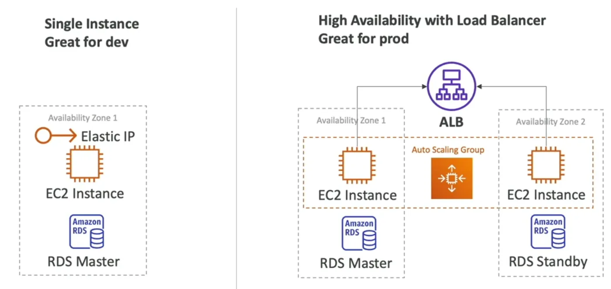

# Beanstalk

`aws` `services`

## SAA
A fully managed service that was built to accommodate a repeating pattern in application development, where an ✅ 4. Solutions Architect - Associate SAA-C03 is used on an ✅ 4. Solutions Architect - Associate SAA-C03. It supports many languages, so you can run pretty much anything on it.
### Components of Elastic Beanstalk
1. Application: Collection of envs, versions, configs
2. Application Version: Iteration of the Application
3. Environment: Collection of AWS resources running an application version, Web Server & Worker Environment Tiers (Pasted image 20250615172521.png).
Multiple environments can be created (dev, test, prod, ...)
Pasted image 20250615172521.png
### Lifecycle
1. Create application
2. Upload Version
3. Launch Environment
4. Manage Environment
Updating a version means going from `4` to `2`.
### Deployment Modes
- Single instance: EC2, EIP, RDS Master
- High Availability with Load Balancer: ALB, ASG, EC2+, RDS Master/Standby

## CCP
**AWS Elastic Beanstalk** is a fully managed service to allow you to deploy [[serverless]] web applications. You tell AWS what kind of resources your app needs to run and AWS will deploy and manage them for you.
- Based off of [[management-and-governance-cloudformation|CloudFormation]] templates.

**AWS Elastic Beanstalk** is the fastest way to get web applications up and running on AWS. You can simply upload your application code, and the service automatically handles details such as resource provisioning, [[autoscaling-groups-and-load-balancers|load balancing, auto scaling, ]]and monitoring. 

Elastic Beanstalk is ideal if you have a PHP, Java, Python, Ruby, Node.js, .NET, Go, or Docker web application. 

Elastic Beanstalk uses core AWS services such as [[compute-ec2-ccp|Amazon Elastic Compute Cloud (EC2)]], [[containers-ecs|Amazon Elastic Container Service (ECS)]], [[autoscaling-groups-and-load-balancers|AWS Auto Scaling, and Elastic Load Balancing (ELB)]]to easily support applications that need to [[scalability|scale]] to serve millions of users.
