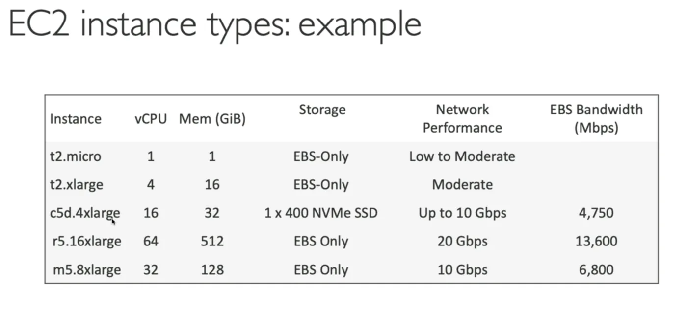
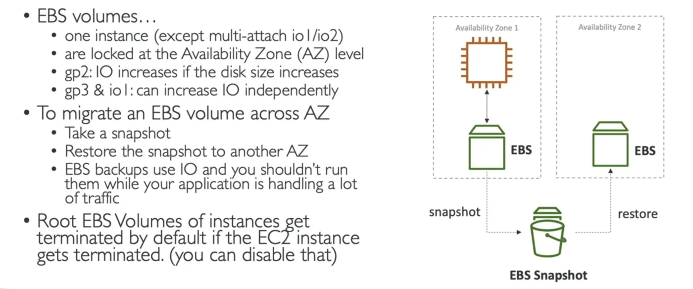
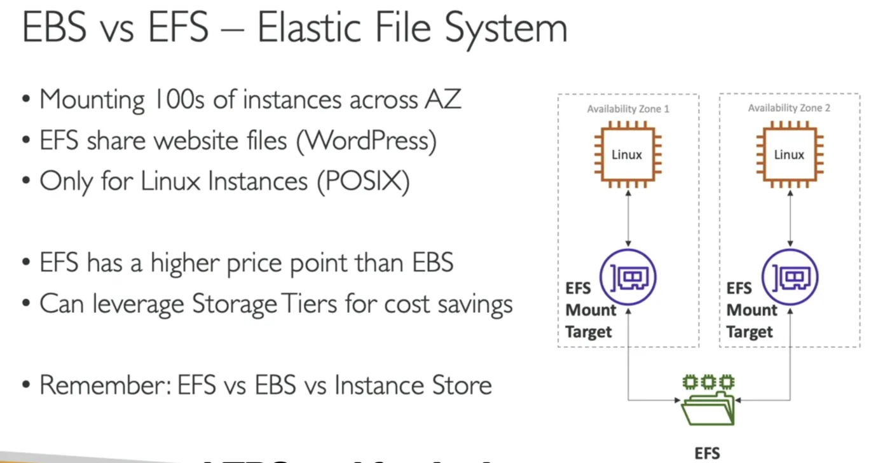

# Ec2

`aws` `services`

## Elastic Compute Cloud EC2
- Setup a Zero-Spend budget on [[financial-management-budgets|AWS Budget]] to prevent racking up a tab
- **IaaS**
### EC2 Instance Power States

| Power state | What happens | Note |
|---|---|---|
| **Stopped** | The data on [[storage-ebs|ebs]] disk remains intact in the next start | - |
| **Terminate** | Any [[storage-ebs|ebs]] volumes also set-up to be destroyed are lost | - |
| **Start** | First start: the OS boots, and the [[ec2-user-data|EC2 User Data]] script is run. Subsequent starts: the OS boots | - |
| **Hibernate** | In-memory state is preserved. The RAM state is written to a file in the root [[storage-ebs|ebs]] volume | See EC2 Hibernate below |
### Sizing and Configuration Options
- OS: Linux, Windows, MacOS
- CPU 
- RAM
- Storage:
	- [[storage-ebs|ebs]] & [[storage-efs|efs]] - Network-attached
	- EC2 Instance Store - hardware
- Network card: speed of the card, public IP address
- Firewall rules: security group
- bootstrap script: [[ec2-user-data|EC2 User Data]]
### Automating Boot Tasks
- Using [[ec2-user-data|EC2 User Data]]
- Installing updates
- Installing software
- Downloading common files
**EC2 User Data scripts run on ROOT account (**sudo** privileges)**
### Some EC2 Instances

[ec2 instance types/](https://aws.amazon.com/ec2/instance-types/)
### Free Tier
`t2.micro` up to 750hrs/month. 750 hours per month of public IPv4 address usage, 30 GiB of EBS storage, 2 million I/Os, 1 GB of snapshots, and 100 GB of bandwidth to the internet.
### Naming Convention
$$m5.2xlarge$$
- m: instance class
- 5: generation (improved overtime)
- 2xlarge: size within the instance class **m**
### EC2 Instance Types

| Family | Use for | Name class |
|---|---|---|
| General Purpose (GP) | Great for a diversity of workloads such as web servers or code repos, balanced (example: t2.micro) | - |
| Compute-Optimized | Compute-intensive tasks that require a high performance processor: batch processing, media transcoding, high performance web servers, dedicated gaming servers | **C** |
| Memory-Optimized | Fast performance for workloads that process data sets in memory: high performance DBs, distributed web scale cache stores | **R**, **X**, **Z** |
| Storage-Optimized | Storage intensive tasks that require high, sequential read and write access to large data sets on local storage: high frequency online transaction processing systems, relational and NoSQL DBs | **I**, **D**, **G**, **H** |
### Security Groups
- **ALLOW** rules only
- Rules can reference by **IP ADDRESS** or other **SECURITY GROUP**
- Firewall on the EC2 instance
- They regulate:
	- Access to ports
	- Authorized IP ranges
	- Control of inbound and outbound network
- by default, **outbound** rule for any port and any IP is **ENABLED**
#### Good to Know
- Can be attached to multiple instances
- Locked down to a [[region]]/[[vpc|VPC]] combination
- Lives outside of EC2 - Any blocked traffic won't reach EC2
- Maintain one security group solely for SSH access
- **Time out = security group issue!**
- **Connection refused = application error / not launched**
### EC2 Instance Connect
- Browser-based SSH client to connect to your EC2 instances
**NO AWS API KEYS IN INSTANCES!**
### EC2 Instances Purchasing Options
[[compute-ec2-ccp|Pricing models]]

| Option | What you get | Note |
|---|---|---|
| Dedicated hosts | Book an entire physical server (allows compliance) | Useful for licensed software |
| Dedicated Instances | No other customer will share your hardware | - |
| Capacity Reservations | Reserve capacity in a specific AZ for any duration | You're charged at On-Demand rate whether you launch instances or not |

### Additional: IPv4 Address AWS Charges 
- $0.005 per hour ($3.6 per month)
- Free tier: 750hrs/month free
### EC2 Spot Instance Requests
- Define a **max spot price** and get the instance while current spot price < max defined
#### Spot Fleets
$$Spot\ Fleet\ =\ set\ of\ Spot\ instances\ +\ (Optional)\ On-Demand\ Instances$$
Strategies for Spot Fleets:

| Strategy | Best for |
|---|---|
| lowestPrice | From the pool with the lowest price (cost optimization, short workload) |
| diversified | Distributed across all pools (great for avail., long workloads) |
| capacityOptimized | - |
| priceCapacityOptimized (recommended) | Pools with highest capacity available, then select the pool with the lowest price |

**Spot Fleets allow us to automatically request Spot Instances with the lowest price.**
### Placement Groups
Sometimes you want control over the EC2 Instance placement strategy
#### Cluster
Clusters instances into a **low-latency** group in the same **AZ**
Pros:
- Great network, 10Gbps bandwidth between instances with Enhanced Networking enabled
Cons:
- If the AZ fails, all instances fail
Use case:
- Big Data jobs that need to complete FAST
- Applications that need extremely low-latency
#### Spread
Spreads instances across underline hardware (max 7 instances)
Pros:
- Can span across AZs
- Reduced risk in failure
- EC2 Instances are on different physical hardware
Cons:
- Limited to 7 instances per AZ per placement group
Use case:
- Application that needs to maximize high availability
- Critical applications where each instance must be isolated from failure from each other
#### Partition
Spreads across many different partitions within an AZ. Scales to 100s of EC2 instances per group.
- Up to 7 partitions per AZ
- Can span multiple AZs in same region
- Up to 100s of EC2 Instances
Use case:
- HDFS, HBase, Cassandra, Apache Kafka
### Elastic Network Interfaces (ENI)
- Logical components in a VPC that represent a virtual network card
- ENI Can have:
	  - Primary private IPv4, one or more secondary IPv4
	  - One Elastic IP (IPv4) per private IPv4
	  - One public IPv4
	  - One or more security group
	  - MAC Address
  - Bound to a specific AZ
### EC2 Hibernate
- In-memory state is preserved. 
- Instance boot time is much faster, as the OS is not stopped
- The RAM state is written to a file in the root [[storage-ebs|ebs]] volume
- The root [[storage-ebs|ebs]] volume must be encrypted
#### Use Cases
- Long-running processing
- Saving the RAM state
- Services that take time to initialize
#### Good to Know
- Supported many instance families
- Instance RAM size must be less than 150 GB
- Instance size - not supported for bare metal instances
- AMI - Amazon Linux 2, Linux AMI, Ubuntu, Windows, ...
- Root Volume - Must be EBS, encrypted, not instance store, and large
- Available for **On-Demand**, **Reserved**, **Spot** instances
- 60-Day limit for hibernation
### Storage Options
#### EBS Volume
[[storage-ebs|ebs]]
Allows your instances to persist data, even after termination.
They are bound to a specific [[availability-zones|availability zones]]. To move to a different AZ, you need to snapshot it.
Think of it as a network USB stick.
Network drives that use the instance. Can be re-attached. Possible to create EBS and leave it unattached.
##### Delete-on-Termination Attribute
Deletes the EBS volume on termination of EC2 instance the volume is attached to.
- By default, the root EBS volume is deleted.
##### Free Tier
30 GB of free [[storage-ebs|ebs]] storage of type General Purpose GP (SSD) or magnetic per month
##### EBS Volume Types

| Type | Kind | Size | Max performance | Use case |
|---|---|---|---|---|
| gp3 | General Purpose SSD | 1GiB - 16TiB | Baseline of 3k IOPS and 125 MiB/s throughput. Can increase IOPS to 16k and throughput 100 MiB/s **independently** | Cost effective, low latency. System boot volumes, virtual desktops, dev and test env |
| gp2 | General Purpose SSD | 1GiB - 16TiB | Small volumes can burst IOPS to 3k. Size of volume and IOPS are **LINKED**: 3 IOPS per GB, so at 5334 GB we are at the max IOPS | Same as gp3 |
| io1 | Provisioned IOPS SSD | 4GiB - 16TiB | Max PIOPS: **64,000** for Nitro EC2 Instances | Critical business apps with sustained IOPS performance, or apps that need more than 16,000 IOPS. **GREAT FOR DATABASES** |
| io2 | Provisioned IOPS SSD | 4GiB - 64TiB | Max PIOPS: **256,000** with an **IOPS:GiB** ratio of 1000:1. Sub-second latency | Same as io1 |
| st1 | HDD | 125GiB - 16TiB | **Max throughput: 500MiB/s, max IOPS 500.** | Low cost, frequent access. Big Data, Data Warehouses, Log Processing |
| sc1 | HDD | 125GiB - 16TiB | **Max throughput: 250 MiB/s, max IOPS 250.** | Lowest cost, less frequent access. When lowest cost is important |

HDD volumes can't be boot volumes.
##### EBS Snapshots
Make a Backup (snapshot) of your EBS volume at a point in time.
- **Not necessary to detach volume to do snapshot, but recommended**
- Can copy snapshots across AZs and Regions
##### Features
- EBS Snapshot Archive
	- Move a Snapshot to an archive tier that is 75% cheaper
	- Takes within 24 to 72 hrs for restoring
- Recycle Bin for EBS Snapshot
	- Setup rules to retain deleted snapshots
	- Specify retention (1day -> 1 year)
- Fast Snapshot Restore (FSR) ($expensive)
##### EBS Multi-Attach - io1/io2 family
- Attach the same EBS volume to multiple EC2 instances in the same AZ
- Use cases:
	- Achieve higher app availability in clustered Linux applications
	- Applications must manage concurrent write operations
- **Up to 16 EC2 instances only**
- **Must use a file system that's cluster-aware** (Not XFS, EXT4, etc)
##### EBS Encryption
- Data at rest is encrypted
- All data in flight is encrypted
- All snapshots are encrypted
- Has minimal impact on latency
- Uses Keys from [[security-kms|kms]] (AES-256)
- Copying an unencrypted snapshots allows encryption
#### Elastic File System EFS
[[storage-efs|efs]]
- Managed NFS (Network File System)
- Can be mounted on many EC2s
- EFS works with EC2 instances in multi-AZ
- Highly available, scalable, expensive (3x gp2), **pay-per-use**
- Uses NFSv4.1 protocol
- **Uses security group to control access**
- **Compatible with Linux-based AMIs (Not Windows**)
- Encryption at rest using [[security-kms|kms]]
- POSIX FS
- File system scales **automatically**, no capacity planning
##### Use Cases
- Content Management
- Web serving
- data sharing
- wordpress
##### Performance Classes
- EFS Scale
	- 1000s of Concurrent NFS Clients, 10GB+ /s throughput
	- Grow to Petabyte-scale NFS, automatically

| Setting | Option | Use for |
|---|---|---|
| Performance Mode | **General Purpose (default)** | Latency-sensitive use-cases (CMS, web server, etc) |
| Performance Mode | **Max I/O** | High latency, throughput, and highly parallel (media processing, big data) |
| Throughput Mode | **Bursting** | 1 TB = 50MiB/s + burst of 100MiB/s |
| Throughput Mode | **Provisioned** | Set your throughput regardless of storage size |
| Throughput Mode | **Elastic** | Automatically scale with throughput up/down based on workload |
##### Storage Classes
- Implement lifecycle policies to move files between storage tiers (move file after N days)
- Over 90% in cost savings by using the correct storage class!

| Dimension | Class | Notes |
|---|---|---|
| Storage tier | **Standard** | Frequently accessed files |
| Storage tier | **Infrequent** access | - |
| Storage tier | **Archive** | 50% cheaper |
| Availability and durability | **Standard** | Great for production, Multi-AZ |
| Availability and durability | **One Zone** | One AZ, great for development, backups, with IA |

### EBS vs. EFS

### Amazon Machine Image (AMI)
- Customization of an EC2 instance
- Can add your own software, config, OS
- AMI are built for a specific region, but can be copied across regions
- AMI Types:
	- Public AMI
	- Your own AMI
	- [[financial-management-marketplace|AWS Marketplace AMI]]
#### Customizing an AMI
- Start an EC2 and customize it
- Stop it
- Build an AMI - this will create an 
- Launch AMI instances from other EC2
Right click on instance -> Images -> Create Image
### EC2 Instance Store
- Better I/O performance
- Lost storage on stop/terminate (a.k.a. ephemeral)
- Good for buffer / cache / scratch data / temporary
- Risk of data loss if hardware fails
- Backups and replications are your responsibility
### EC2 Instance Profiles
>Think of it as of a single identity that a group of instances can have (e.g. your scalegroup instances share single instance profile, hence a single entity name assuming a role)
---
