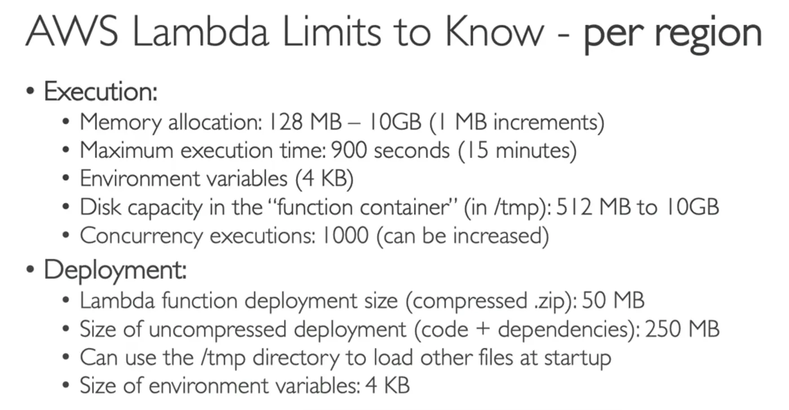
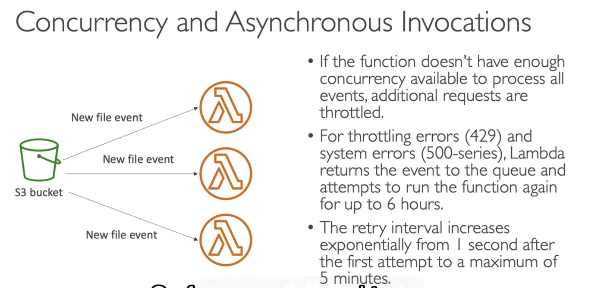
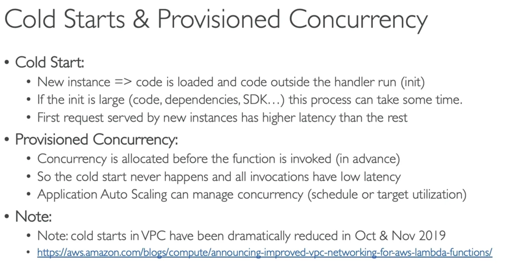
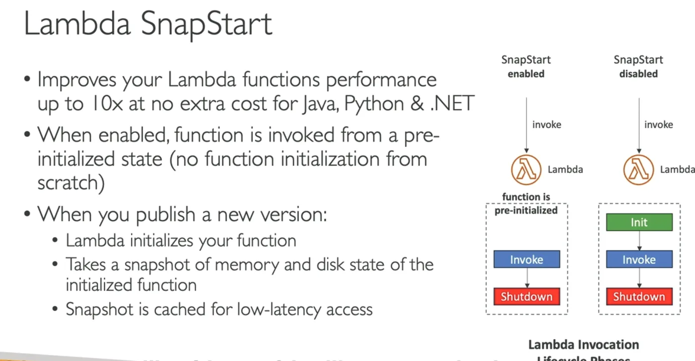
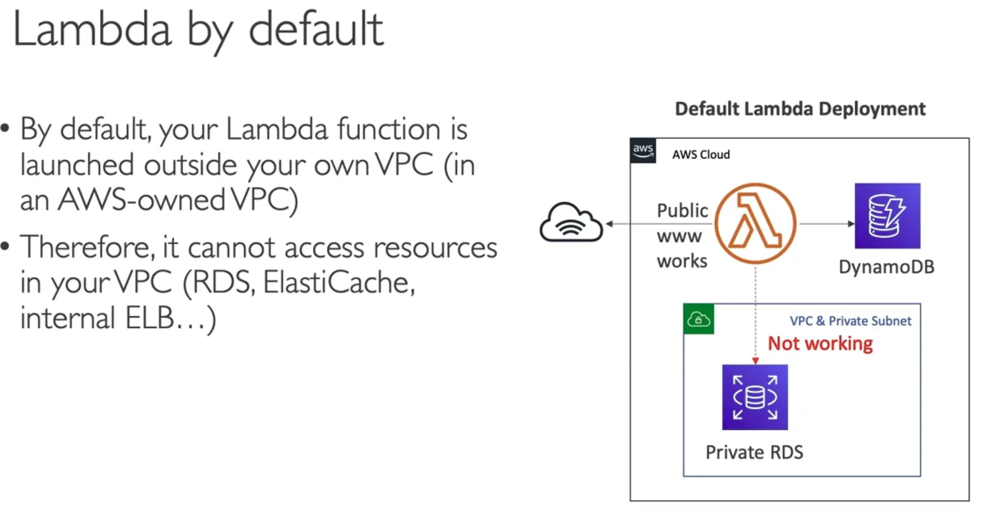
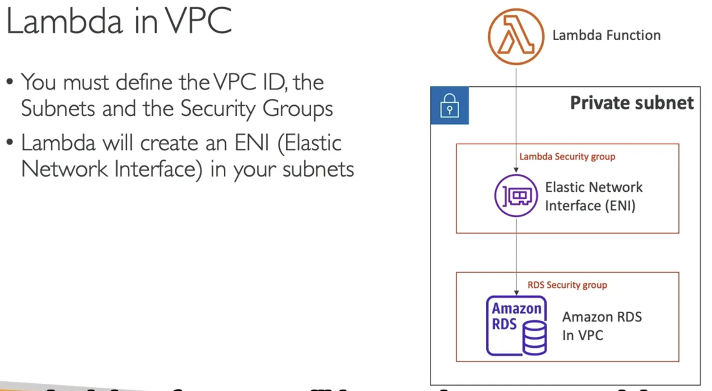
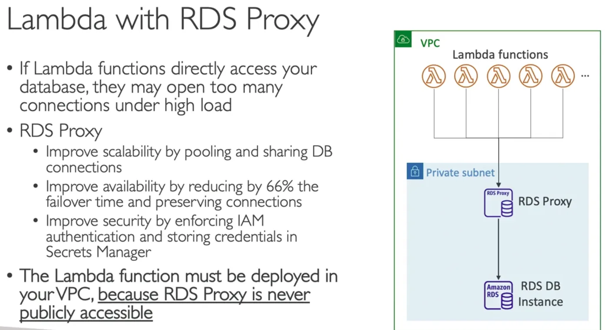
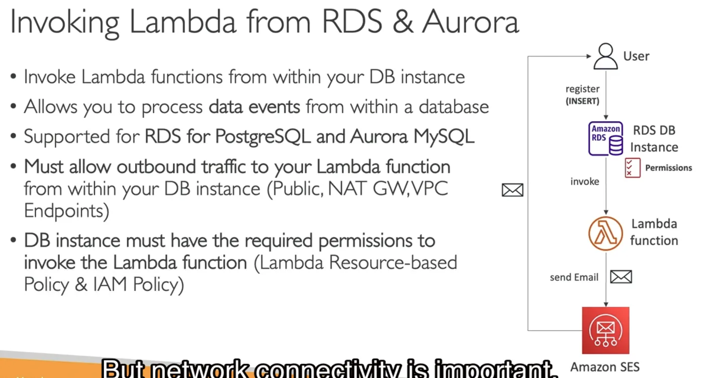

# lambda

`aws` `services`

**AWS Lambda** is the primary [[serverless]] compute tool. Used to run code without provisioning servers.
 
AWS Lambda is a [[aws-compute|compute]] service that runs your code in response to events and automatically manages the compute resources, making it the fastest way to turn an idea into a modern, production, [[serverless]] applications.
## Use cases
- Quickly process data at scale
- Run interactive web and mobile backends
- Enable powerful ML insights
- Create event-driven applications

## Lambda SnapStart

### Defaults

### Lambda in VPC

### Lambda + RDS Proxy

