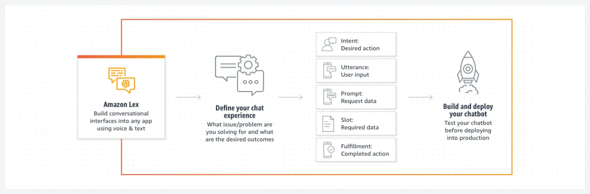

# Lex

`aws` `services`

Build text and voice chatbots.

"Add sophisticated, natural language, AI-powered chatbots to new and existing applications."

"Powered by the same technology as Alexa, Amazon Lex is an AI chat builder that allows users to interact with any application using natural language voice or chat. Use Amazon Lex to build and deploy conversational AI interfaces for any application. Integrating AI chat into existing business processes and use cases gives users more flexibility and support to get work done in ways that are natural to your users. AI chat experiences in customer-facing applications enhance customer satisfaction."

