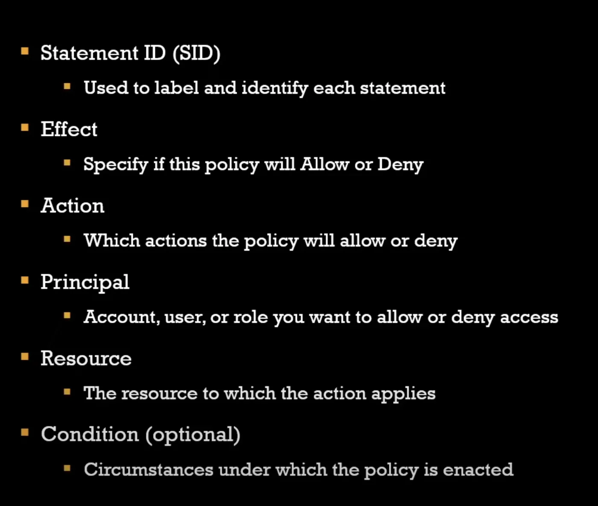

# user and identity management

`aws` `services`

- When giving permissions to users, always follow [[principle-of-least-privilege|principle of least privilege]]!
- Consider organizational compliance standards
- Utilize multiple layers of authentication, such as [[multi-factor-authentication|MFA]] on top of passwords for access.
## Identity Access Management (IAM)
**GLOBAL**
AWS's key service for managing users and permissions, based on JSON documents.
There are three types of IAM identities:
1. Users - End users that login to the console or need programmatic access.
2. Groups - Groups of end users that you can setup to share the same permissions. (i.e. Marketing group, Communications group, etc).
3. Roles - Used to grant other AWS services permissions to do specific API actions.
### IAM policies

### 3rd Party Identity Providers
[[security-cognito|cognito]]
### Root User account
A special account created upon the creation of your AWS account that **has full access to everything**, and **uses email/pass to login.**

Should be extremely well-secured with [[multi-factor-authentication|multi factor authentication]] and extremely limited with access. THere are only a few certain scenarios where you need to login to this account. Everything else can be done with [[security-user-and-identity-management|IAM]] admin user.

Scenarios that ****REQUIRE**** root user:
- Changing account settings like email address, account name
- restore IAM user permissions
- activate IAM access to billing console
- Close your AWS account
- change/cancel AWS support plan
## [[application-integration|application integration]]
