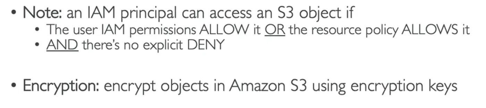
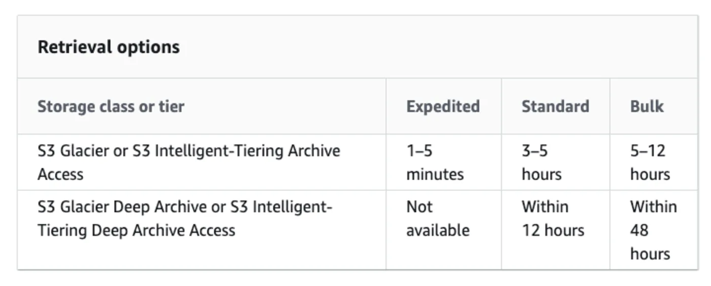
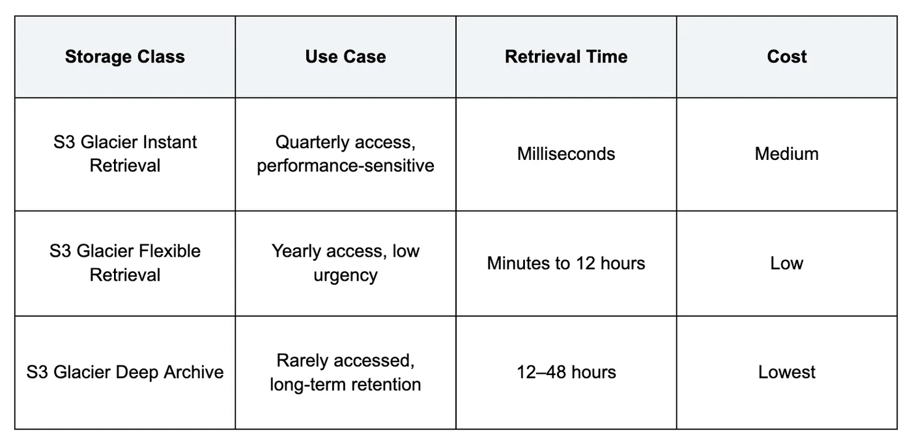
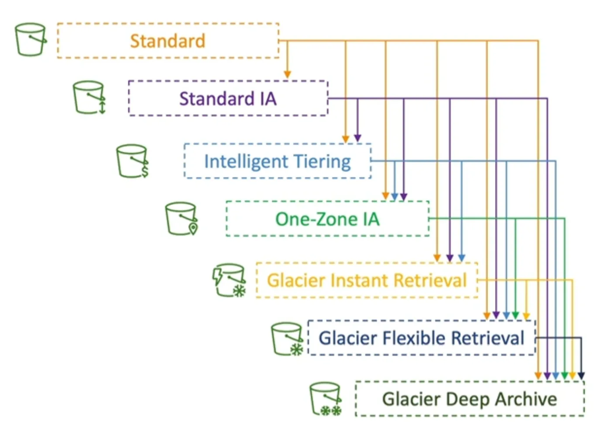
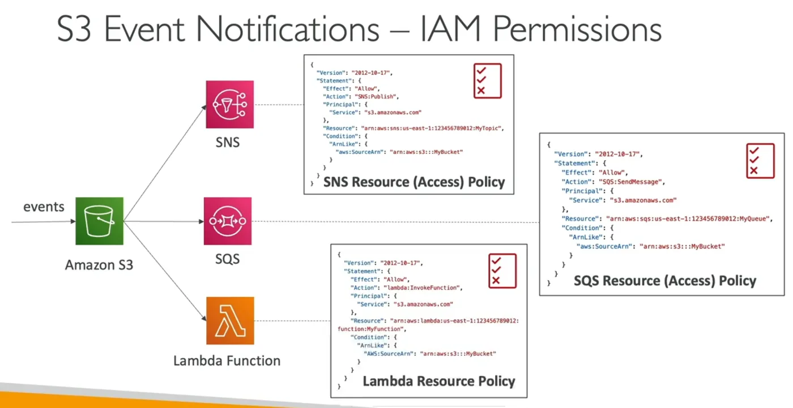
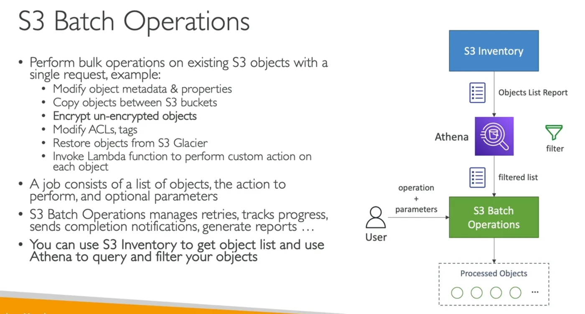
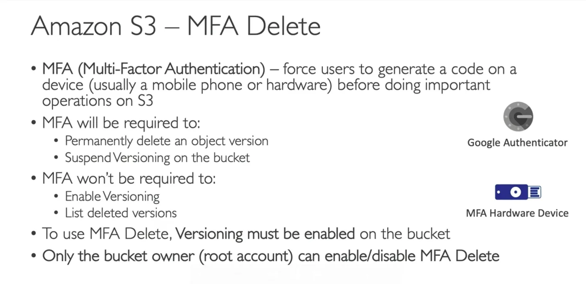
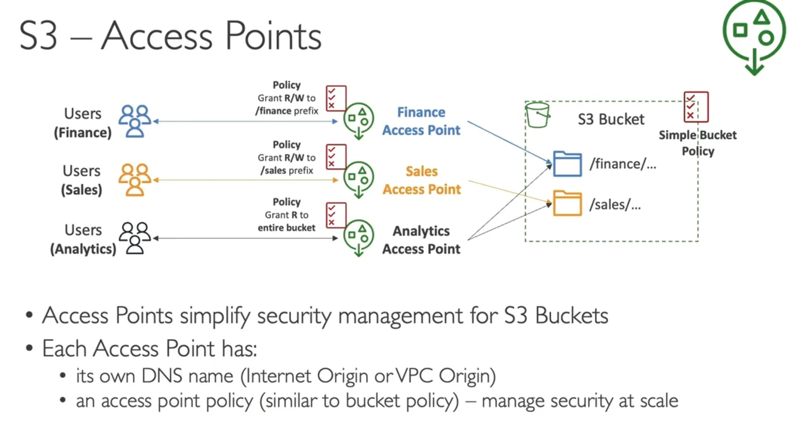
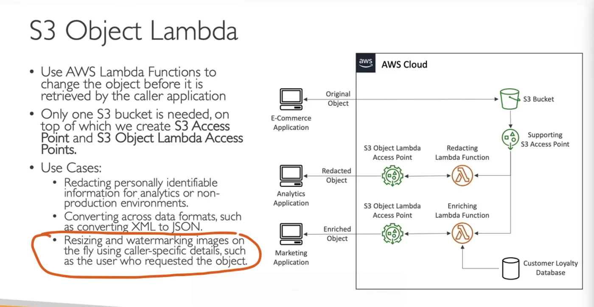

# s3

## SAA
Simple storage service. Buckets are used to contain Objects, which are files you upload. Objects have **keys**, these keys are the path to the object in the s3 bucket.
- Buckets should be all lowercase.
- Although it might look like a global service, each bucket lives in a single region.
- Bucket names must be **universally unique** across ALL regions.
- Maximum file size is **5TB**, and for anything larger, you'll perform multi-part upload.
- Objects have version ID (if **versioning** is enabled), Tags, and Metadata.
### Versioning
Enables multiple versions of files instead of overwriting them. When enabled, deleted files are instead marked for deletion with a "delete marker" that hides them, and they can be recovered
### Bucket Security

| Security type | Mechanism | Notes |
|---|---|---|
| User-based | IAM Policies | Grants IAM **users**/**roles** the ability to access buckets and objects |
| Resource-based | Bucket Policies | Bucket-wide rules that allow cross-account access |
| Resource-based | Object Access Control List | Finer grain and control on security |
| Resource-based | Bucket Access Control List | Less common |

### Retrieval Times
#### Glacier

### Moving Between Tiers
Objects can be moved to lower tiers manually or automatically, using **Lifecycle Rules**. 

### Lifecycle Rules
- Transition Action
	- "Move to glacier after 6 months"
- Expiration Action
	- "Delete after x months"
#### Improving Lifecycles
Using S3 Analytics for Storage Class Analysis
### Requester Pays
The object owner pays for storage cost, and the requester pays for downloading the object. **Requester must be AWS authenticated.**
### Event Notifications
Events that trigger on Object operations (creation, removal, ...)
Notification Targets: **SNS**, **SQS**, **Lambda**, or **EventBridge** (which can send them to over 18 AWS services)

### Baseline Performance
Requests per second per prefix in a bucket, AT LEASE:
- 3500 `PUT/COPY/POST/DELETE`
- 5500 `GET/HEAD`
### Performance Optimization
- Use **Multi-part upload** for > 100MB, MUST use for > 5GB
- **S3 Transfer Acceleration**: Upload file to Edge location, then Edge location forwards the file to the S3 bucket.
- **S3 Byte-Range Fetches**: Parallelize GETs by requesting byte ranges.
### Batch Operations

### Storage Lens
Reports about the S3 storage across the entire AWS Organization displayed on a prebuilt dashboard, or you can create you own dashboard. The metrics reported include: 
- Summary metrics 
- Cost-Optimization metrics 
- Data-Protection metrics 
- Access-Management metrics 
- Event metrics 
- Performance metrics 
- Activity metrics 
- Detailed Status Code metrics
There are **Free** (28 metrics, 14-day query availability) and **Paid** metrics.
### Encryption

| Option | Key | Notes |
|---|---|---|
| SSE-S3 | S3-provided key | Default |
| SSE-KMS | KMS-generated key that you have access to | **$** to create custom KMS key |
| SSE-C | Customer-provided key | Customer provides the key in the upload request header, S3 encrypts the object and discards the key. Must use HTTPS. (Only done through AWS CLI) |
| Client-side Encryption | - | Client encrypts object before upload |

To force secure transport on HTTPS (for SSE-C): Add a deny action to a role with the condition that `aws:SecureTransport = false`
**Bucket policies will always be evaluated before "Default Encryption"**
### CORS - Cross-Origin Resource Sharing
$$Origin\ =\ scheme\ (protocol)\ +\ host\ (domain)\ +\ port$$
Used when getting resources from a different origin that the one you're on.
### MFA Delete

### Pre-Signed URLS
URL Expiration:
- S3 Console - 1min to 720
- AWS CLI - 3600secs to 604800
Users given a pre-signed URL inherit the perms of the user that generated the URL for GET/PUT.
### S3 Glacier Vault Lock
Adopt a **Write-Once-Read-Many** model. Create a **Vault Lock Policy.** 
### S3 Object Lock (+ Versioning)
Prevents an object version from deletion for a specified amount of mode.

| Mode | Who can delete | Can change retention | Notes |
|---|---|---|---|
| Compliance Mode | Can't be deleted by ANYONE | No (also can't change mode) | - |
| Governance | Most users can't delete | Some users have special perms to change the retention or delete | - |
| Legal Hold | - | - | Indefinite protection of the object. `s3:PutObjectLegalHold` |
### S3 Access Points

VPC Origin needs a VPC Endpoint for access to the VPC.
### S3 Object Lambda

---
## CCP
**Simple Storage Service**
Consists of objects and buckets:
- Object - What actually contains your data, similar to a file. Consists primarily of key/value pairs.
- Bucket - What holds your objects. Can contain folders. **Name must be globally unique.**
### Storage classes

| Storage class | Best for | Notes |
|---|---|---|
| S3 standard (default) | - | Most expensive. Highly available. Replicates at least 3 [[availability-zones|availability zones]]. Very fast data retrieval |
| S3 intelligent tiering | - | Uses ML to move objects to most appropriate storage class |
| S3 Standard-IA (Infrequent Access) | Objects accessed less than once a month | Cheaper than standard |
| S3 one-zone IA | - | Same as IA, but data only lives in one availability zone, so it's cheaper |
| S3 **glacier** | Long term storage ideal for archives | Very cheap but data retrieval takes minutes to hours |
| S3 Glacier deep archive | - | Same as glacier but **cheaper and slower** |
