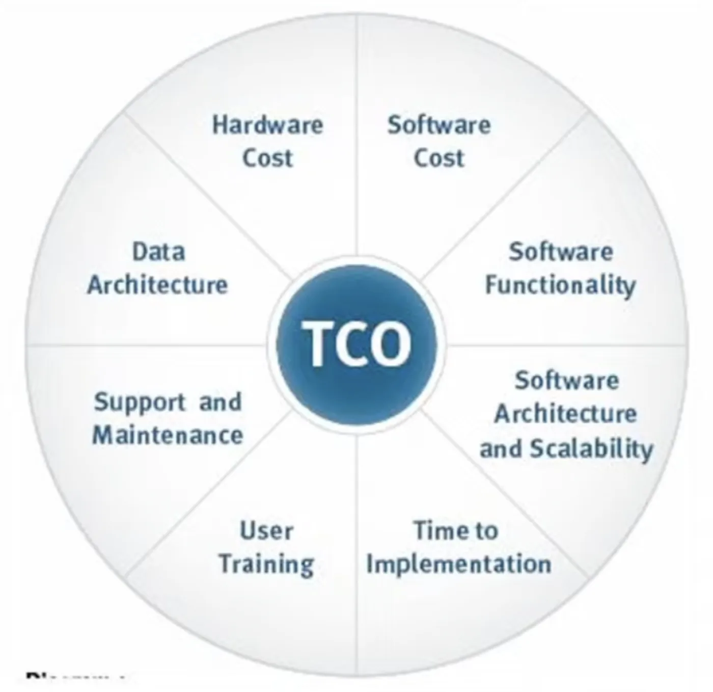

# Total cost of ownership

`gcp`

Total cost of ownership (TCO) is the full cost of owning and running a system, including hardware, facilities, and staff.

TCO is one of the largest value additions for using the cloud.

Compare the cost of:
- Owning and maintaining your own on-premise physical servers and data centers, and hiring people to do it
- Using AWS servers and adopting a pay-as-you-go model.

[[financial-management-pricing-calculator|pricing calculator]]
