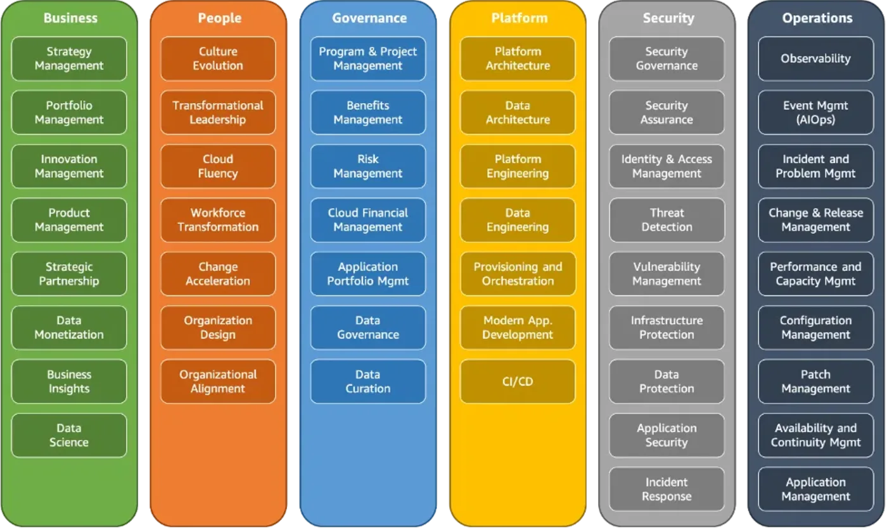
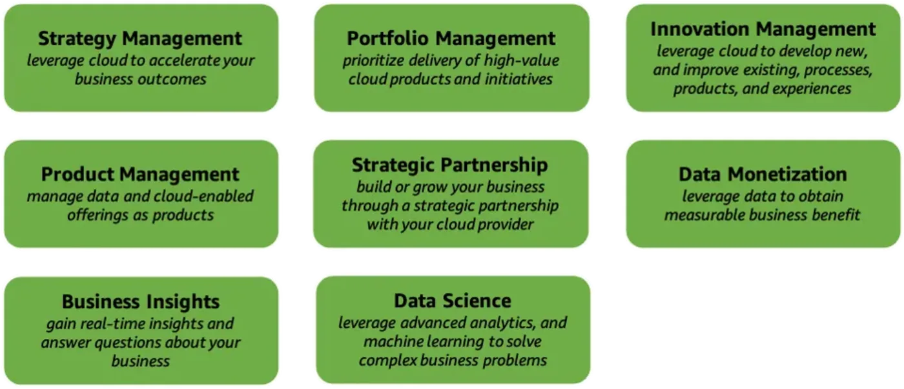
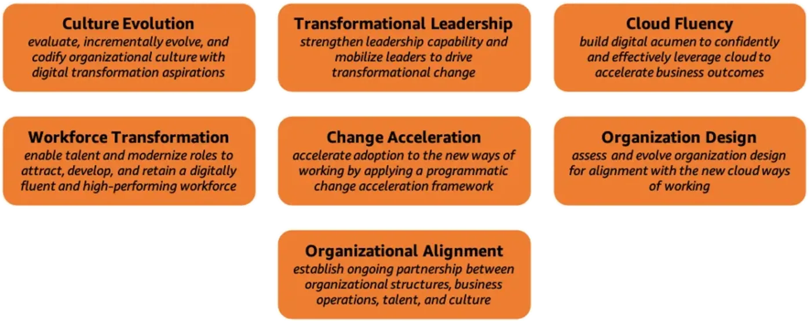
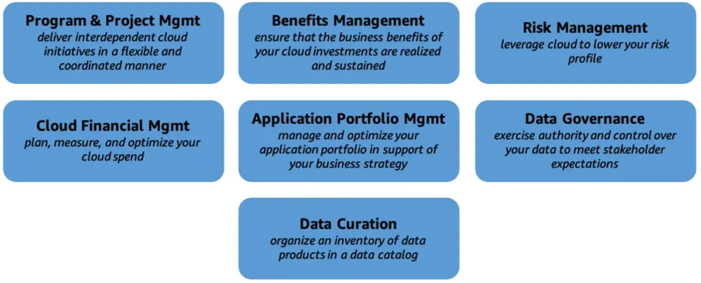
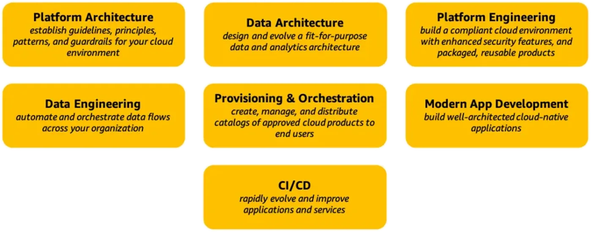
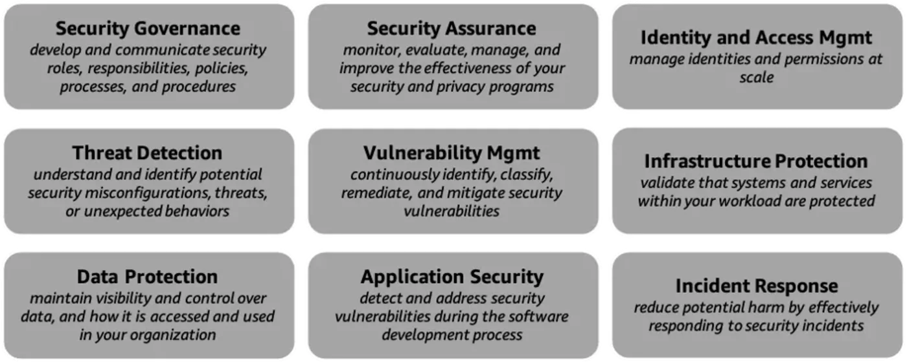
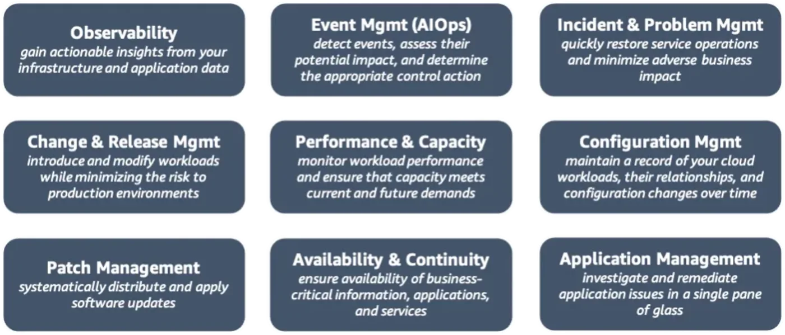

<!-- imported from ObsidianVault/studies/cloud-architecht/unsorted/cloud adoption framework.md. Edit the source, then run sync.py. -->

# Cloud adoption framework

`gcp`

https://abhi0751.medium.com/aws-cloud-adoption-framework-aws-caf-a512b89dbcba
## Summary
"You are correct, there are a lot of buzzwords involved. The basics are:
- Get [[c-suite|C-suite]] behind the effort, this means really behind the effort, when disputes arise (and they will) [[c-suite|C-suite]] needs to support cloud
- train your people (don't just hire replacements)
- hire a few experienced folks (depending on your company size)
- make sure your risk/security/bean counters are on board and understand their new world
- start having a plan on how to migrate apps, or groups of app to the cloud
- make sure your security people know what they are doing, instead of just saying 'no' expect them to provide 'no, but this is how...' answers
- have a few persons or a team (based on your company size) for ops/sre"
[source](https://www.reddit.com/r/aws/comments/upmi5n/can_someone_explain_the_cloud_adoption_framework/i8on0x1/)
## From AWS Docs
"The AWS Cloud Adoption Framework (AWS CAF) leverages AWS experience and best practices to help you digitally transform and accelerate your business outcomes through innovative use of AWS. AWS CAF identifies specific organizational capabilities that underpin successful cloud transformations." 

- **Business perspective** helps ensure that your cloud investments accelerate your digital transformation ambitions and business outcomes. Common stakeholders include chief executive officer (CEO), chief financial officer (CFO), chief operations officer (COO), chief information officer (CIO), and chief technology officer (CTO).

- **People perspective** serves as a bridge between technology and business, accelerating the cloud journey to help organizations more rapidly evolve to a culture of continuous growth, learning, and where change becomes business-as-normal, with focus on culture, organizational structure, leadership, and workforce. Common stakeholders include CIO, COO, CTO, cloud director, and cross-functional and enterprise-wide leaders.

- **Governance perspective** helps you orchestrate your cloud initiatives while maximizing organizational benefits and minimizing transformation-related risks. Common stakeholders include chief transformation officer, CIO, CTO, CFO, chief data officer (CDO), and chief risk officer (CRO).

- **Platform perspective** helps you build an enterprise-grade, scalable, hybrid cloud platform, modernize existing workloads, and implement new cloud-native solutions. Common stakeholders include CTO, technology leaders, architects, and engineers.

- **Security perspective** helps you achieve the confidentiality, integrity, and availability of your data and cloud workloads. Common stakeholders include chief information security officer (CISO), chief compliance officer (CCO), internal audit leaders, and security architects and engineers.

- **Operations perspective** helps ensure that your cloud services are delivered at a level that meets the needs of your business. Common stakeholders include infrastructure and operations leaders, site reliability engineers, and information technology service managers.

