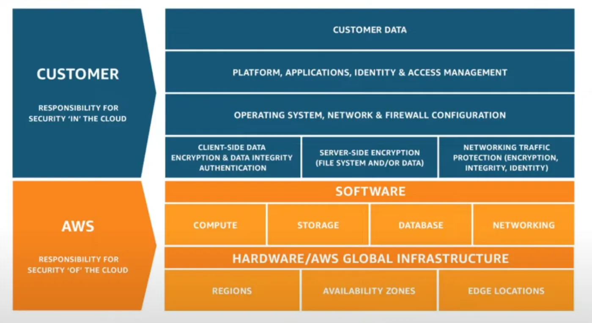

<!-- imported from ObsidianVault/studies/cloud-architecht/unsorted/cloud concepts.md. Edit the source, then run sync.py. -->

# Cloud concepts

`gcp`

start @ [[certificate-topics|certificate topics]]

What is cloud computing? [[cloud-computing|cloud computing]]

Cloud providers:
1. They own the servers
2. They hire the IT people
3. They pay or rent the real-estate
4. You are responsible for your configuring cloud services and code, they take care of the rest.

## Evolution of Cloud Hosting

1. [[dedicated-server|dedicated server]]
2. Virtual Private Server ([[vps]])
3. [[shared-hosting|Shared Hosting]]
4. [[cloud-hosting|cloud hosting]]

## Cloud Service providers

[[csp]]

## Gartner Magic Quadrant for Cloud

Shows which CSP is leading the way in cloud services.

## IaaS core services

1. **Compute** - A virtual PC (or multiple)  (**[[compute-ec2-ccp|ec2-ccp]]**)
2. **Networking** - Virtual network defining connections or services **(VPC)**
3. **Storage** - Virtual hard drive (**[[storage-ebs|EBS]]**)
4. **Database** - Virtual database for storing report data **([[database-aws-database|RDS]])**

[stopped @ 35:05](https://youtu.be/SOTamWNgDKc&t=2105) 

## Shared Responsibility Model

### AWS' responsibilities
- Hardware/global infrastructure
- Software for Compute, Storage, Database, Networking services
## YOUR responsibilities
- Securing data via client/server-side encryption
- Configs of Virtual Infrastructure
- Configs of managed services or 3rd party software

## Benefits of using the cloud

- **Agility** - Increase the agility of the business
- **Pay as you go pricing** - Trade capital expenses for operating expenses
- **Economy of scale** - Benefit from massive economies of scale
- **Global reach** - Go global in minutes
- **Security** - 
- **Reliability** - Performs how you need it
- **Availability** - Accessible when needed
- **[[scalability|Scalability]]** - Grows with demand
- **Elasticity** - Quickly add or remove resources

## Advantages of AWS
1. Trade capital expense for variable expense
	1. There are no upfront costs to using resources
2. Benefit from massive economies of scale
3. Stop guessing capacity
4. Increase speed and agility
5. Stop spending money on data centers
6. Go global in minutes

## Global AWS Infrastructure
What makes the cloud possible. The network of computers, servers, etc, around the world that you pay to use.

1.  [[region|regions]] - Geographical location comprised of data center clusters.
2. [[availability-zones|Availability zones]] - One or more physical data centers within a [[region]] that have their own power, networking, and connectivity to each other within a [[region]].
3. [[edge-location|Edge locations]] - A site used to cache copies of data for faster delivery.
## AWS Well-Architected Framework
Your Architecture should be well thought out and designed.

1. Operational excellence [[operational-excellence-pillars|operational excellence pillars]] - Run and monitor systems, provide most business value
2. Security [[security-pillars|security pillars]] - Protect data and systems, mitigate risk
3. Reliability [[reliability-pillars|reliability pillars]] - Mitigate and recover from disruptions
4. Performance efficiency [[performance-efficiency-pillar|performance efficiency pillar]] - Use resources efficiently
5. Cost optimization [[cost-optimization-pillar|cost optimization pillar]] - Pay the lowest cost possible

[stopped at 41:22](https://www.youtube.com/watch?v=JsmhEgIV1mQ)

## Tenets of AWS

[[tenets-of-aws|tenets of aws]]

## [[scalability|Scalability]] vs Elasticity

"[[scalability|Scalability]] is the ability of the system to accommodate larger loads just by adding resources either making hardware stronger (scale up) or adding additional nodes (scale out).

Elasticity is the ability to fit the resources needed to cope with loads dynamically usually in relation to scale out. So that when the load increases you scale by adding more resources and when demand wanes you shrink back and remove unneeded resources. Elasticity is mostly important in Cloud environments where you pay-per-use and don't want to pay for resources you do not currently need on the one hand, and want to meet rising demand when needed on the other hand." [What is the difference between scalability and elasticity? - StackOverflow](https://stackoverflow.com/a/9610186)

## Management and Development tools

1. Management Console - User friendly web based interface
2. [Software Development Kits](https://aws.amazon.com/sdk-for-javascript/) (SDK) - Make your code compatible to run and manage AWS resources.
3. Command Line Interface (CLI) - Used to programmatically make changes to your AWS resources
Always secure access and limit who can access your resources!

## AWS Account ID

**SECURE it.** 12-digit series that references an AWS account.

## AWS Management Console

Most user-friendly way to interact with and manage AWS resources.

## AWS Access Keys

Required to have programmatic access to AWS resources outside the console.

Components:
1. Access Key ID
2. Secret access key

They have the same permissions as the user they're attached to.

## Services

1. [[aws-compute|aws compute]]
2. [[aws-storage|aws storage]]
