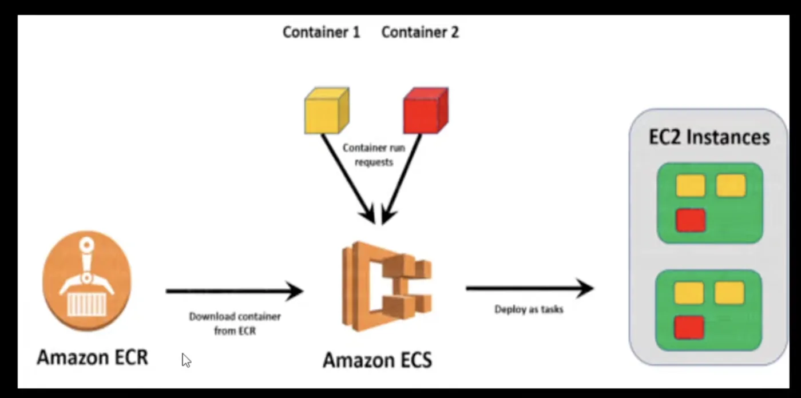

# Containers

`cloud` `fundamentals` `containers` `kubernetes`

Containers allow you to run multiple applications on the same [[compute-ec2-ccp|ec2-ccp]] instance that are =**completely isolated from eachother**=.

A container comes with everything an application needs to run, regardless of the O.S.

