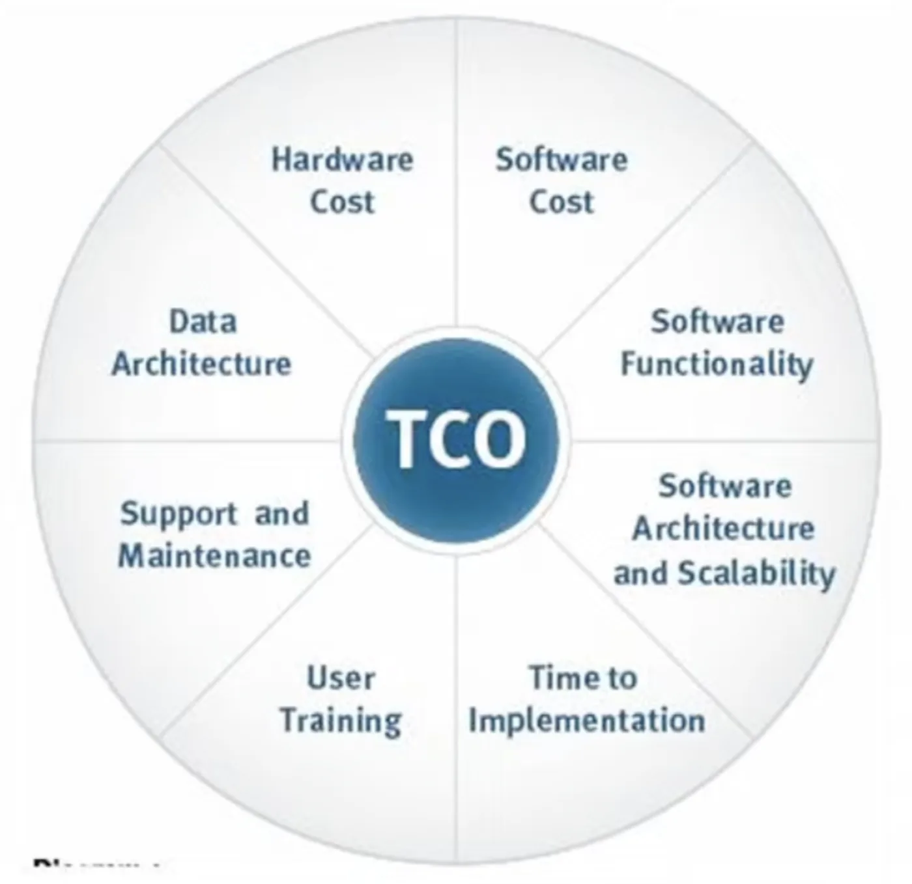

<!-- imported from ObsidianVault/studies/cloud-architecht/unsorted/total cost of ownership.md. Edit the source, then run sync.py. -->

# Total cost of ownership

`gcp`

**TCO**

TCO is one of the largest value additions for using the cloud.

Compare the cost of:
- Owning and maintaining your own on-premise physical servers and data centers, and hiring people to do it
- Using AWS servers and adopting a pay-as-you-go model.

pricing calculator
