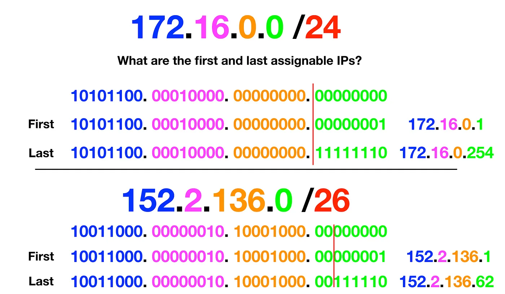

# Cidr

`cloud` `fundamentals` `networking`

CIDR (Classless Inter-Domain Routing) is a notation that writes an IP address range as an address plus a prefix length, such as 172.16.0.0/24.

## 0.0.0.0/X
For every 8X, an entire slot from the left is static.
