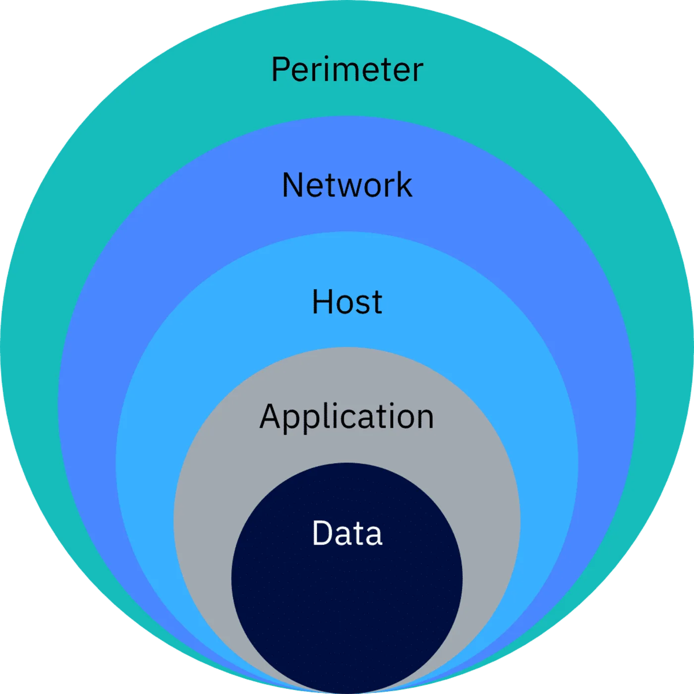

# Attack prevention strategies

No strategy is perfect or unbeatable. Attackers keep finding new ways to make defenses obsolete.

A more realistic goal is to make attacks more difficult to achieve.

## Strategies

| Strategy | What it means |
|---|---|
| Reduce the attack surface | Remove entry points. See [[attack-surface]]. |
| Create a DMZ | Place public-facing systems in a separate segment. See [[demilitarized-zone]]. |
| Follow least privilege | Give each user only the access they need. See [[principle-of-least-privilege]]. |
| Manage software vulnerabilities | Monitor and mitigate vulnerabilities. Apply patches as fixes become available (patch management). |
| Use defense in depth | Layer several defenses so one failure does not expose everything. |

## Defense in depth

- Firewalls: network defense.
- Malware scanners: device defense.
- Encryption: data defense. See [[cryptography]].

Next: [[attack-detection]].
