<!-- imported from ObsidianVault/studies/cloud-architecht/✅ 5. Terraform Associate 003.md. Edit the source, then run sync.py. -->

# ✅ 5. Terraform Associate 003

`certification`

https://www.youtube.com/watch?v=SPcwo0Gq9T8

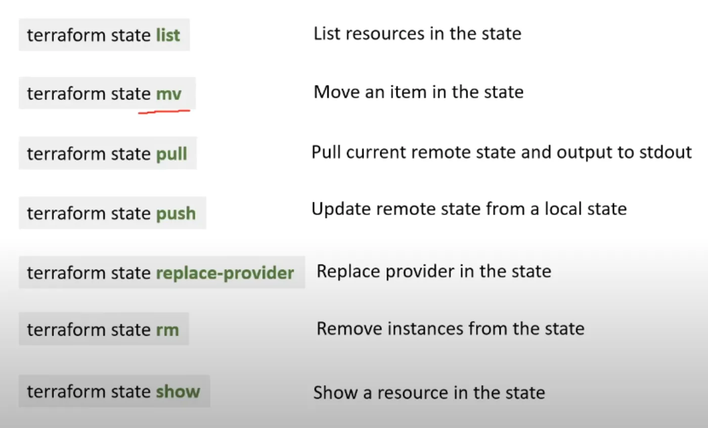
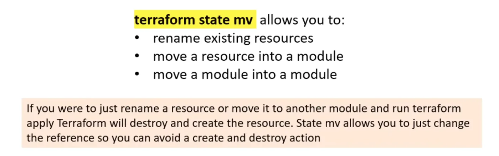
## `terraform init`
once a Terraform file is ready, `cd` into its directory and run this command.
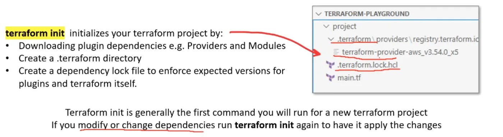
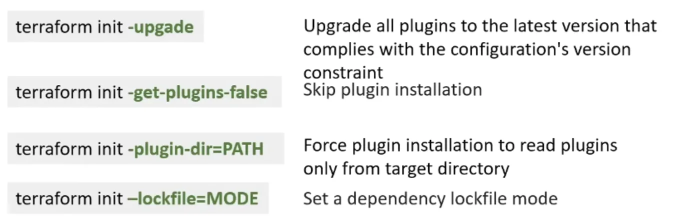
## `terraform plan`
Displays the planned changes. Kinda like `git status`
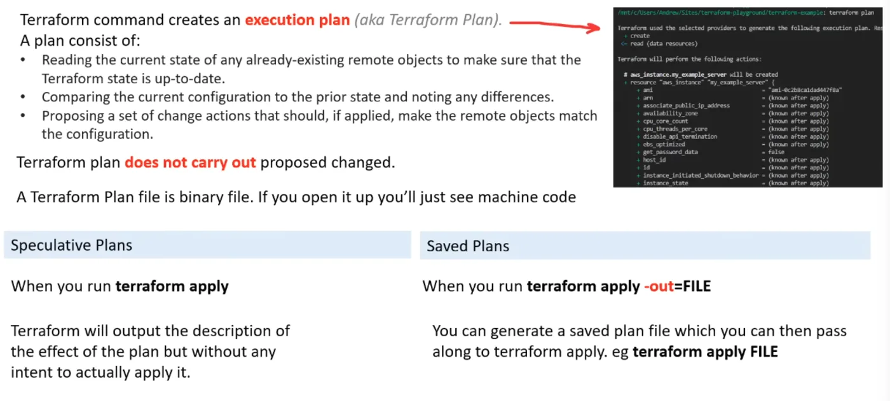
## `terraform apply`
Actually runs the `.tf` file.
## `terraform destroy`
Destroys the entire resources found in the `.tf` file. Alternatively, to delete a resource, just comment it out.
## `terraform get`
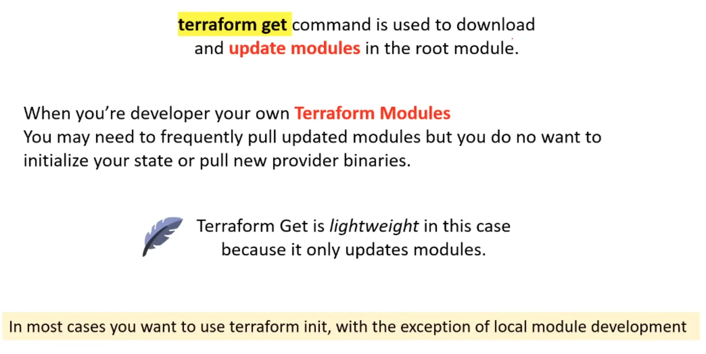
## `terraform graph | dot -Tsvg > graph.svg`
Visualize your execution plan
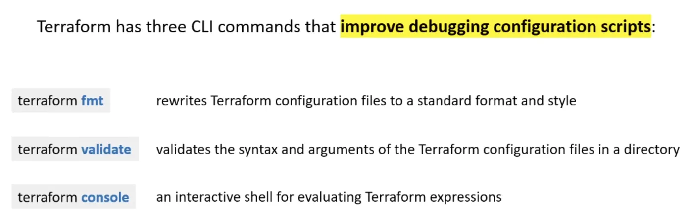
## Output block
```
output "public_ip" {
	value = aws_eip.example.public_ip
}
```
## `terraform.tfvars`
A file that contains variables
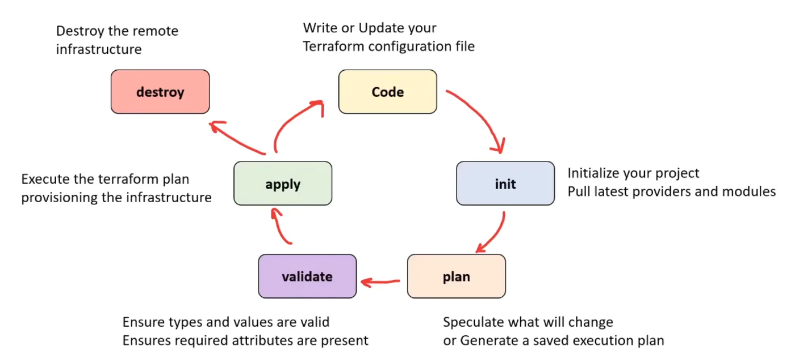
## Variable Precedence
Terraform loads variables in the following order, with later sources taking precedence over earlier ones
1. Environment variables
2. The `terraform.tfvars` file, if present.
3. The `terraform.tfvars.json` file, if present.
4. Any `*.auto.tfvars` or `*.auto.tfvars.json` files, processed in lexical order of their filenames.
5. Any `-var` and `-var-file` options on the command line, in the order they are provided. (This includes variables set by a Terraform Cloud workspace.)
## Provisioners
### Local-exec
Executes code on the machine that ran `terraform apply`
You can specify an `interpreter`
### Remote-exec
Executes code on a remote target resource after a resource is provisioned
### File
used to copy files from local to resource
### Connection
Tells a provisioner or resource how to establish a connection
like ssh
### Null resource
placeholder resource
"Triggers"
### Data (`terraform_data`)
Recommended to use instead of 
Similar to  but doesn't require the configuration of a provider
Can be used to search
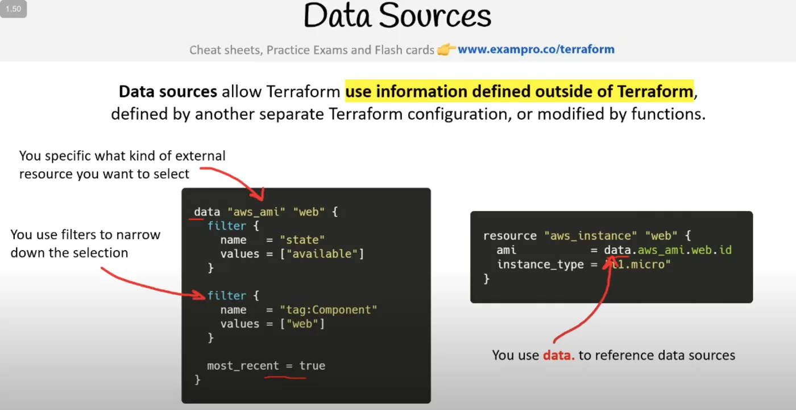
## Resource Behaviors & Lifecycles
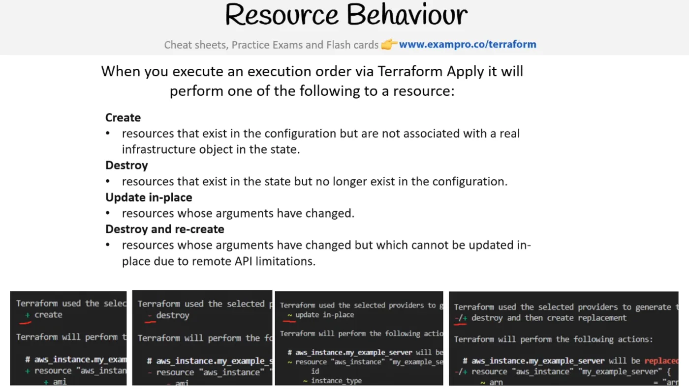
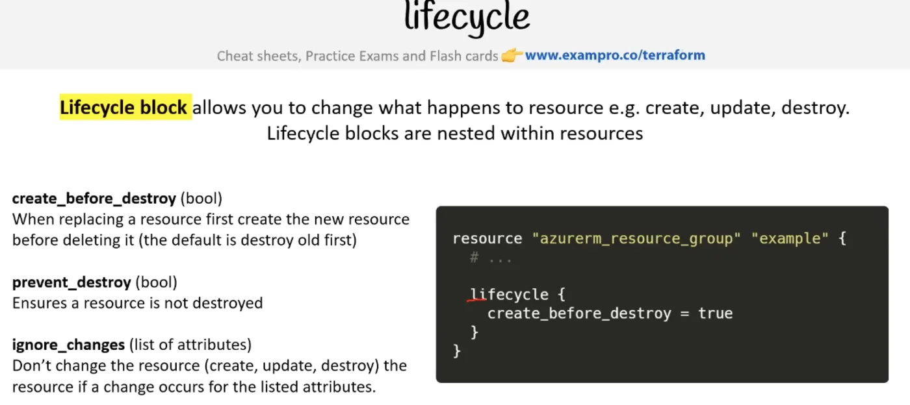
## Resource Drift
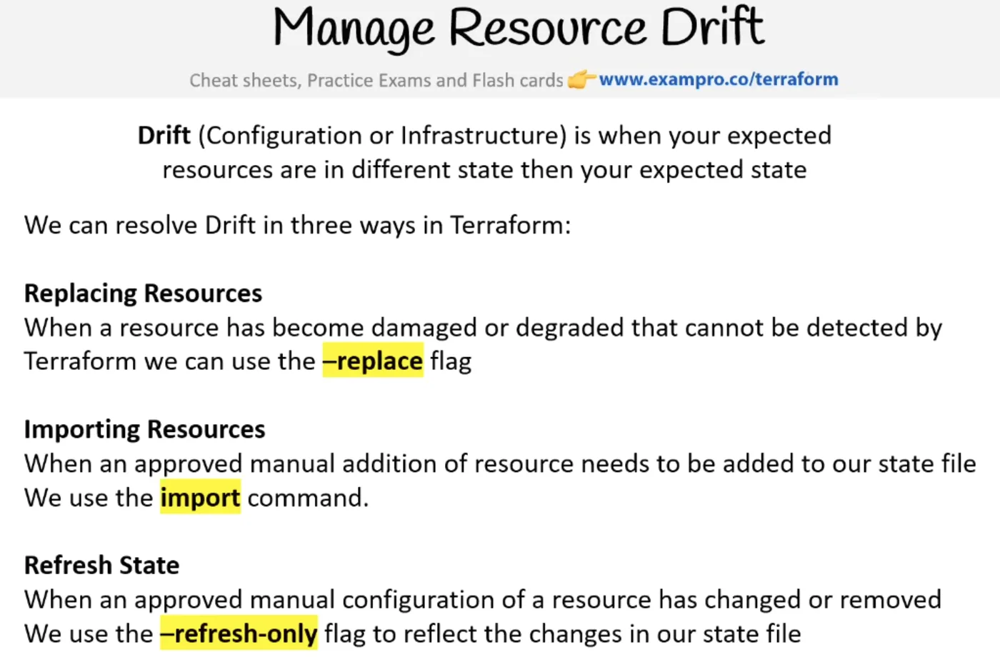
### Replace / Taint
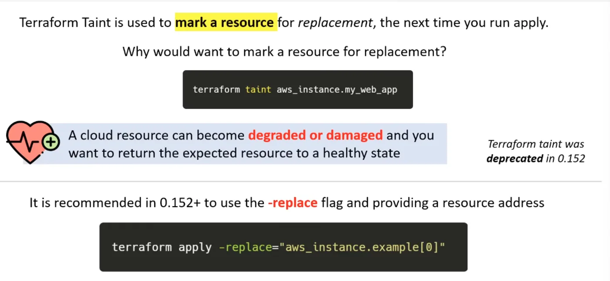
### Import
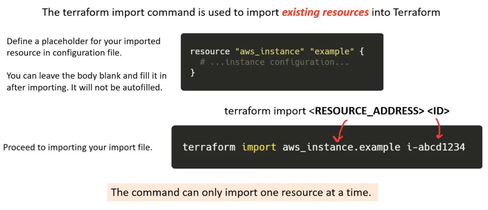
### Refresh
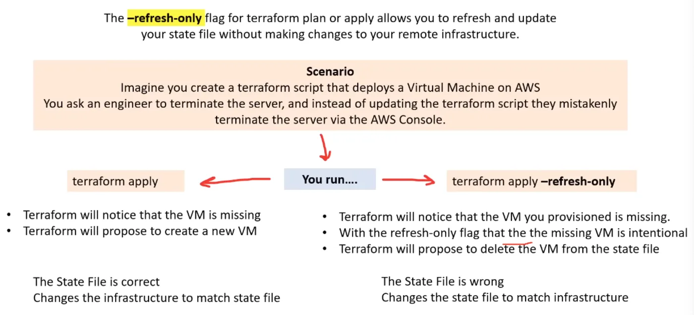
## Troubleshooting
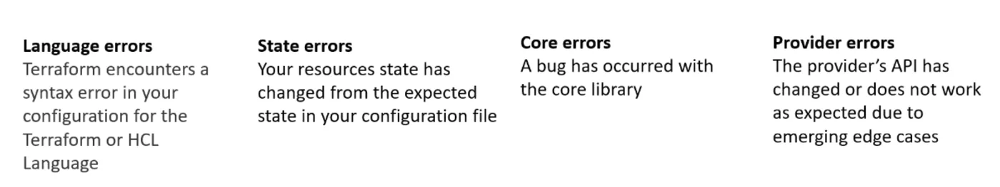
## Debugging
`TF_LOG=<TRACE | DEBUG | INFO | WARN | ERROR | JSON>`
`TF_LOG_PATH`
## Backends
Where operations are performed and where tfstate snapshots are stored
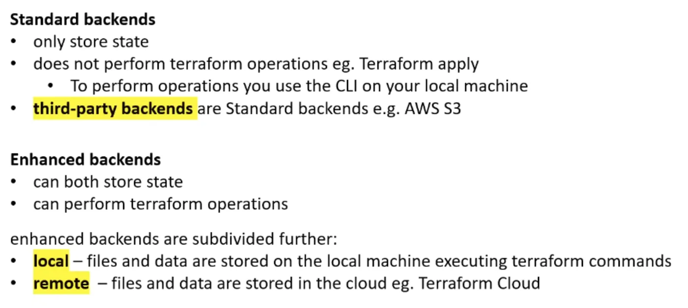
