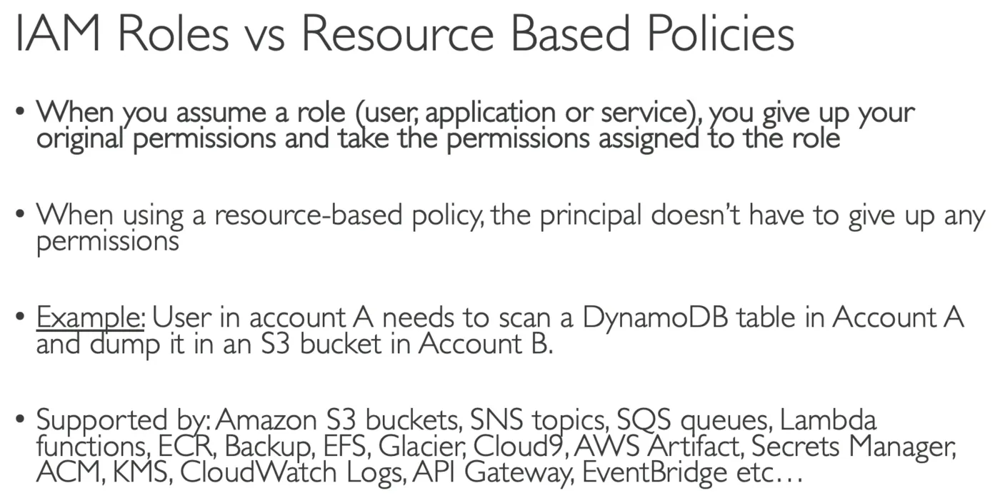
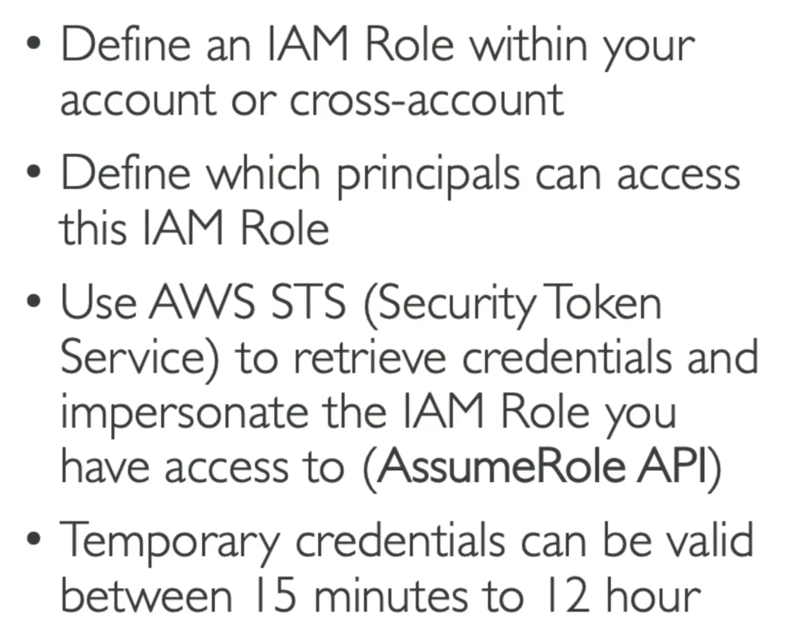

<!-- imported from ObsidianVault/studies/cloud-architecht/6. Solutions Architect - Professional SAP-C02.md. Edit the source, then run sync.py. -->

# 6. Solutions Architect - Professional SAP-C02

`certification`

## Strategy
- Take notes and finish each category on **Maarek**, visit **Cantril** for hands-on labs, read on category til good. Move to next category and **repeat**.
## [[aws/security-iam|IAM]] Policies
- **Not Actions**: Exclude from an Allow/Deny rule
### IAM Roles vs Resource Based Policies
  
### IAM Access Analyzer
Find out which resources are shared externally
- [[aws/storage-s3|S3]] Buckets
- IAM Roles
- [[aws/security-kms|KMS]] Keys
- Lambdas
- [[aws/application-integration-sqs|SQS]] Queues
- Secret Manager Secrets
Define a Zone of Trust, which is an account or Org. Any access outside of zone of trust is a **finding**
#### Policy Validation
Validates your policy against IAM policy grammar and best practices, alerts, warns and suggests changes, and provides actionable recommendations.
#### Policy Generation
Fine-grained IAM policies based on access activity for the past 90 days. Reviews [[aws/management-and-governance-cloudtrail|CloudTrail]] Logs for a services and generates an IAM policy that is tailored to the service and the services it accesses based on the logs.
## Security Token Services (STS) Assume Roles

### 3rd Party Role Assume
- Use External ID to prevent deputy confusion attacks
