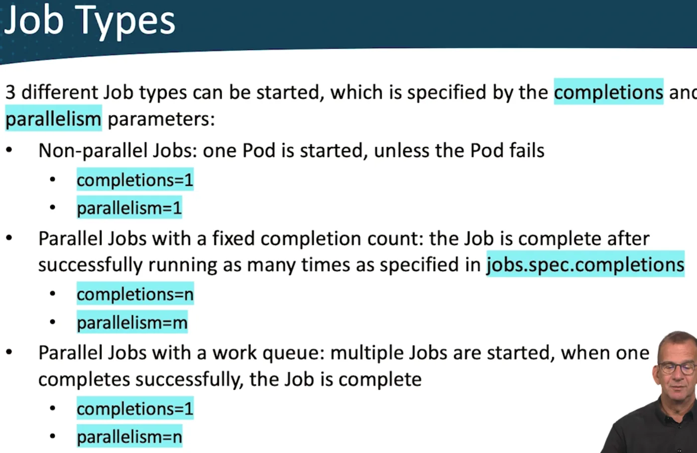
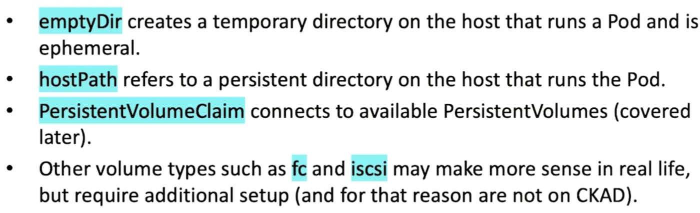
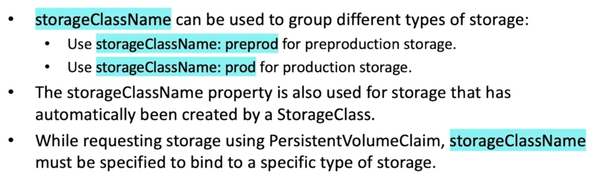
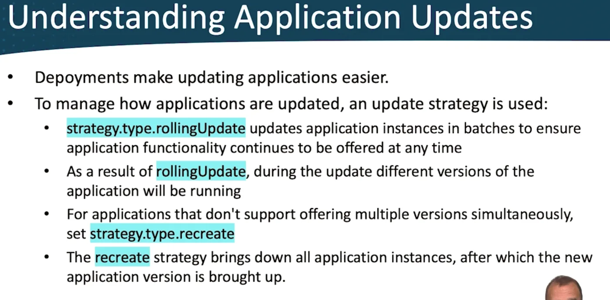
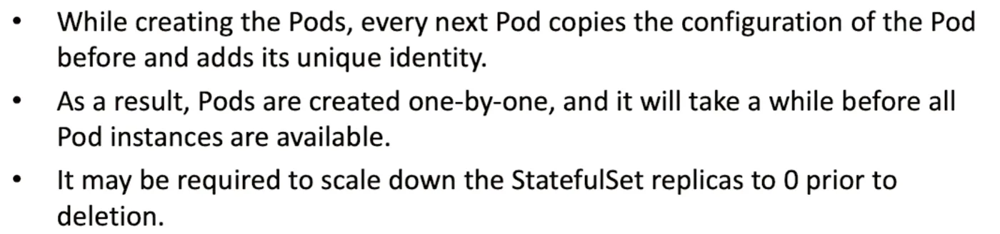
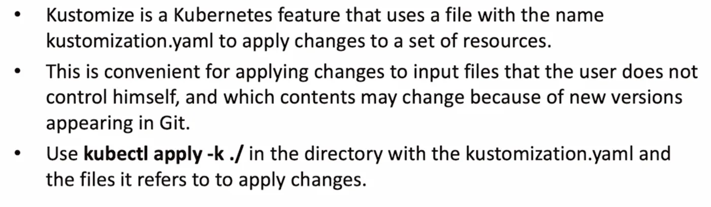
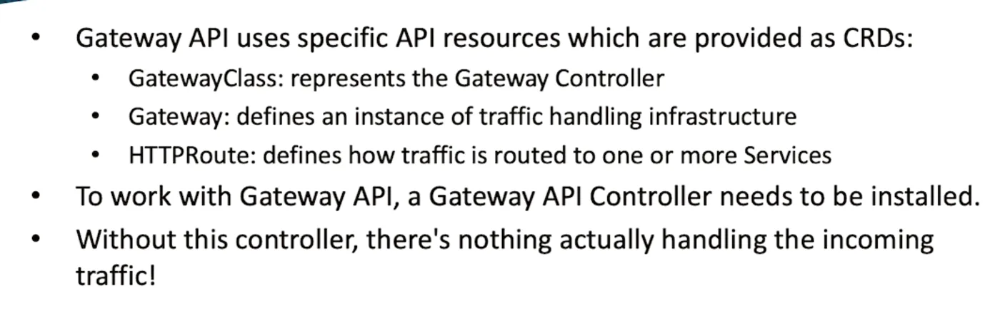
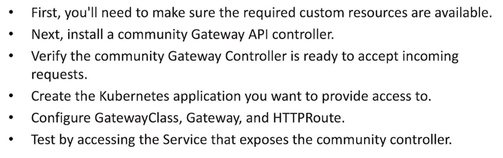
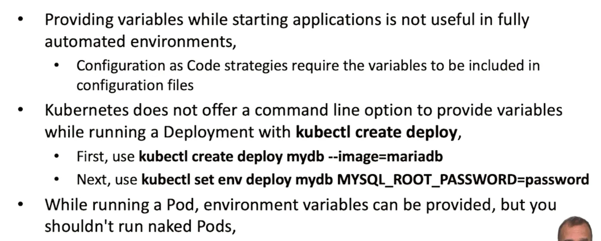
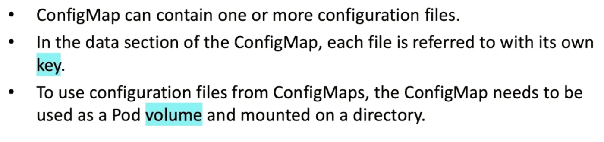

# ✅ 7. Certified Kubernetes Application Developer CKAD

`certification`

```bash
# get the YAML file for a deployed pod with name <pod-name>
kubectl get pod <pod-name> -o yaml
```
## InitContainers
Containers that run before the main container and have to succeed for the main container to run. **The InitContainer shuts down after**.
### Sidecar Container
An InitContainer that has `restartPolicy: Always`, so it doesn't shutdown like the InitContainer.
### Jobs
Start containers with `restartPolicy: never`, so for one-time workloads. Backup, calculations, etc.
`spec.ttlSecondsAfterFinished` is recommended.
### Job Types

## Storage
Ephemeral storage bad because it can only be accessed by a single application instance (host-bound)
To resolve this, we use Pod `volumes` property (Not necessarily persistent volumes!) in `pod.spec.volumes`

To use a pod volume, they must be mounted using `pod.spec.containers.volumeMounts`
### Volume Types


## Deployments
by default all deployments made using `kubectl create deploy` will have the label `app=<deployment_name>` and all pods created using `kubectl run` will have `run=<pod_name>`
Labels are a good way to group resources. Use `kubectl get all --selector app=my_app` to find all resources with label `app=my_app`
Setting a label on an already existing deployment does NOT inherit it into the resources managed by the deployment
To remove a label, use `kubectl label key-` (the minues)
### Annotations != labels
Annotations are for notes/comments. Use `kubectl annotate deploy <deployment_name> newnote="My new note"` to add a new annotation
### Deployment Scalability
Using a **ReplicaSet**
`kubectl scale deploy d_name --replicas=4`
### Application Updates

**rollingUpdate**: 
- `maxSurge` how many application instances during the update, can go above the desired number of pods 😊
- `maxUnavailable` how many instances can be temporarily unavailable.
Both Params can be `int` or percentage.
### Deployment History
During deployment updates, a new ReplicaSet is created that uses the updated properties. The old ReplicaSet is kept, but it's number of replicas/pods is set to 0.
`kubectl rollout history`
`kubectl rollut undo --to-revision=1`
## StatefulSet
- StatefulSets maintain the ID of the pods even if they are restarted. Useful for Databases.
- Useful when one of the following is required:
	- Stable, unique network identifiers
	- Stable, persistent storage
	- Ordered, graceful deployment and scaling
	- Ordered and automated rolling updates
- Easier with Helm charts.
- Storage: `volumeClaimTemplate` which generates a PVC that connects to a PV.
- Deleting a StatefulSet does not delete the associated volume.
- 
### DaemonSet
- Deployment that starts one Pod instance in every node in the cluster.
- Useful when an agent is needed, like AWS [[management-and-governance-cloudwatch|CloudWatch]] Agent.
- When nodes are added or removed, the DaemonSet automatically changes the number of pods accordingly.
### AutoScaling
- HorizontalPodAutoscaler observes usage statistics and after passing a threshold, will add additional replicas. 
## Helm & Kustomize

or `kubectl delete -k`
## Networking
### Service
A Service is used to expose a set of Pods. Services apply round-robin load balancing to forward traffic.
The set of pods that is targeted by a service is determined by a selector.
- `ClusterIP`: Default type, exposes the service internally
- `NodePort`: Allocates a specific port on the node that forwards to the service IP address on the cluster network
- `LoadBalancer`: External load balancer to handle incoming traffic to **applications in public cloud**
- `ExternalName`: works on DNS names; redirection is happening at a DNS level, which is **useful in migration**
- `Headless`: a Service used in cases where direct communication with Pods is required, which is used in StatefulSet.
#### Create Services
`kubectl expose ... --port N` / `kubectl create service ... --port N`
In most cases, you'll expose Deployments
- `targetPort`: The port on the container
- `port` the port in which the service is accessible
- `nodePort`: the port exposed externally when you use a `NodePort` service
### K8s DNS
`servicename.namespace.svc.clustername`
Use FQDN if the two pods are in different namespaces
#### NetworkPolicy
Limits traffic between namespaces. Check labels for ingress/egress in the network policy to identify what it applies to
### Istio
Service mesh. Makes sense in microservices and complex m.s. For BIG environments.
### Ingress
Replaced by , but still required in the exam.
#### Ingress Components
Provide external access to internal cluster resources.
#### Ingress Path Types
- Exact: matches paths that match the specified path exactly
- Prefix: matches paths with specified prefix
### Gateway API
routing and traffic management policies. Supports UDP, TCP, gRPC, traffic Splitting and mirroring, websocket protocols

#### Using Gateway API

## ConfigMaps (#113)
Store site-specific information  
- Stores variables
- Config file storage up to a size of 1MiB
- If more size is needed, store in volume
Create a ConfigMap
`k create cm --from-literal key=value [or --from-env-file path/to/file`
Connect it to a deployment
`k set env --from=configmap/my_cm deploy/mydeploy [--prefix="TF_VAR_"]`


### Using Config Files from ConfigMaps

## Secrets
Base64 encoded alternative for ConfigMap. Not really a secret since it can be decoded. Not encrypted.
- `generic`: like passwords
- `tls`: stores tls keys
- `docker-registry`: used to store registry access credentials
`k create secret tls my-tls-keys -- cert=tls/my.crt --key=tls/my.key`
If it contains variables, use `k set env`
If it contains files, mount the Secret.
Use `defaultMode` to `400`: `...volumes.secret.defaultMode: 0400`

For Registry, `pod.spec.imagePullSecrets`
 
## K8s the DevOps way
