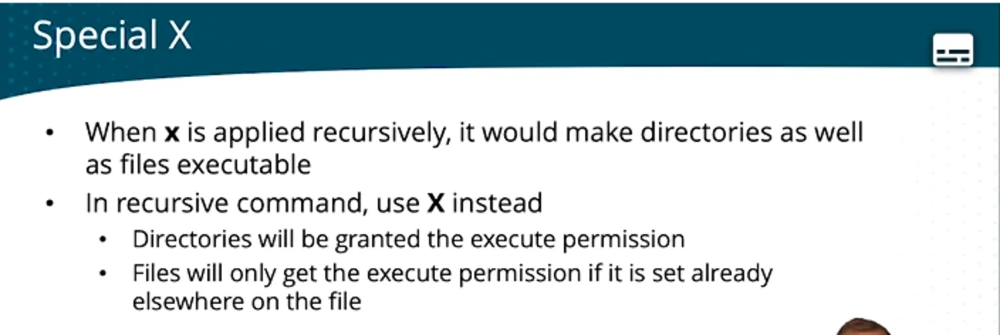
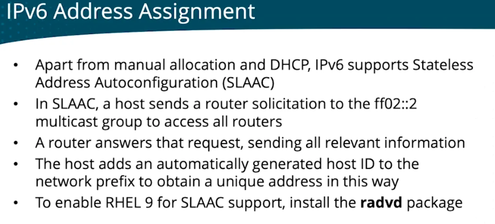

<!-- imported from ObsidianVault/studies/cloud-architecht/8. Red Hat Certified System Administrator RHCSA.md. Edit the source, then run sync.py. -->

# 8. Red Hat Certified System Administrator RHCSA

`certification`

Red Hat Enterprise Linux lifecycle is 10 years.
Linux FSs = `ext3, ext4, xfs`
## The Linux Filesystem
Everything in Linux FS is a **FILE**.
Root directory folders/files.
- `bin` & `sbin` - binaries, `sbin` = super user binaries
- `etc` - configuration files
- `var` - temporary files and logs, but `journald` is taking over
- `tmp` - temp, any user can write to it
`man hier` - information about the file hierarchy
`ssh` access for root user is DENIED by default
`sudo visudo` edit sudo configurations
`Defaults    timestamp_type=global,timestamp_timeout=60` - re-prompt for `sudo` password after 60 minutes, instead of 5
### Mounting Filesystems
To access a device, it must be connected to a directory. This connection is `mounting`.
`mount /dev/<device_name> /<dir_name>`
`findmnt` finds all currently mounted devices
`lsblk` shows all AVAILABLE devices, even unmounted ones
`umount` unmounts
## File Maintenance Commands
- `chgrp <to_group_name> <file_name>` - Change group of `<file_name>`
- `chown <to_group_name> <file_name>` or `chown <new_user_owner>:<new_group_owner> <file_name>` Change ownership of `<file_name>`
- `cp -r <dir>` - copies `<dir>` folder and its contents
- `find /etc -type f -size +100M -exec grep -l student {} \;` - Finds **files** (`-type f`) that are greater than 100 Megabytes (`-size +100M`), and with the result executes a command `grep -l student {}` (`\;` ends the command by escaping `;` and `{}` is the result of the `find` as an argument)
- `find / -name '*' -type f | xargs grep "127.0.0.1"` - `xargs` uses the first command as an argument to the second command
### Tape Archiver (`tar`)
- Doesn't compress by default
`tar -cvf my_arch.tar /home/etc` - creates an archive
`tar -tvf ...` - lists the contents of an archive
`tar -xvf ...` extracts to the current dir. use `-c <dir>` to change extract location.
for adding compression, use:
- `-z` - `gzip` fastest
- `-j` - `bzip2`
- `J` - `xz` (very good compression, slow)
#### Other compression utils
- `gzip` most common
- `bzip2`
- `zip`
## Soft (symbolic) and Hard Links
`inodes` are pointers to a file on the hard disk.
- A `soft link` is a link to a file will be removed if file is removed or renamed. Basically it will stay but won't be able to access the content. **Linking should be for FULL PATH.**
	- cmd: `ln -s`
- A `hard link` is a link to a file will NOT be removed if file is removed or renamed. A hard link connects straight to the inode. They only work on the same partition
	- cmd: `ln`
### Copy (cp) vs Hard Link (ln)
With a copy, you get a new inode and the same content of the original. A hard link shares the same inode as the original, while maintaining its content.
## Managing Text Files
- `less`
- `head` shows the first `n` lines and `tail` shows the last `n` lines, with no args, `n=10`
- `cat -A` prints non-printable characters, shows as `$`
	- `-b` numbers lines
	- `-s` suppresses repeated empty lines
- `tac` reverse order `cat`
- `cut -d : -f 1 /etc/passwd` filters output by `:` and shows the first column (`1`)
- `sort`
- `tr` - translate. `echo hello | tr a-z A-Z` outputs `HELLO`.
- `tr [:lower:] [:upper:]` useful in scripts
- `grep`
	- `-v` exclusions
	- `-A n` after and `-B n` before, show n lines after/before the result
	- `-R` recursive
	- `l` just the names of the files containing the substring
- Always put your regex between single quotes
- `awk` text processing util. for data extraction
	- `awk -F : '{ print $4 } /etc/passwd` - Field separator , print 4th column in /etc/passwd 
	- `aws -F : '{ print $NF }' /etc/passwd` - `NF` end of line column
- `sed` search and transform text
	- `sed -i s/boot/beet/g users` - replaces `boot` to `beet`, `/g` is for global, replace all occurrences
	- `sed -i -e '10d' users` - `-e` edit, `10d` tenth line delete
## I/O Redirects
- Standard input (`stdin`) File descriptor 0
- Standard output (`stdout`) FD 1
- Standard error (`stderr`) FD 2
### stdout 1
By default, when running a command, its output goes to the terminal.
You can redirect the output into a file using `>`.
cmd: `ls -lah > directory_listing.txt`
Use `>>` to append.
### stdin 0
Used when feeding file contents to a file
cmd: `cat < file_1`
### stderr 2
Keyboard is stdin 0
Terminal is stdout 1
Errors are sent to stderr 2
`ls -l /root 2> errorfile`
`2> /dev/null` ignore errors
### Pipes
Chain commands by using the output of one command directly to the input of another command.
`cmd1 | cmd2` - Output of `cmd1` is used as input for `cmd2`
### History
`~/.bash_history`
`!42` - repeats command #42 from the `history`
`!b` - repeats the most recent command starting with a "b"
`history -w` sync current history to history file
`history -d n` removes line `n` from history
`history -c` clears history
## Keyboard shortcuts
- `Ctrl-c` quits process
- `Ctrl-a` moves cursor to the beginning of the line
- `Ctrl-e` end of line
- `Ctrl-r` reverse search in history
- `Ctrl-l` clear screen
- `Ctrl-u` clears line
## Shell expansion
- `ls *`
- `touch file{1..9}` - iterates
- `export x=50` x is saved as a variable, but doesn't persist on relogs. `export` exports the variable to subprocesses of the shell.
## Help Commands
- `whatis cmd`
- `cmd --help`
- `man cmd`
- `where cmd`
- `which cmd`
## User Account Management
- `useradd`
```bash
useradd -g superheros -s /bin/bash -c "user description" -m -d 'home/spiderman spiderman
```
- `groupadd`
```bash
groupadd heroes
```
- `userdel`
- `groupdel`
- `group mod`
- `usermod`
## `/etc/passwd`
Contains user account info and properties 
1. Name
2. Password
3. User ID **UID**
4. Group ID **GID**
5. GECOS: Additional non-mandatory info about the user
6. Home dir
7. Shell: Program that will start on successful authentication
	1. Regular users `/bin/bash`
	2. System users `/sbin/nologin`

## `/etc/skel` 
contains files that will be added to the user's home dir when a new user is created
### `/etc/login.def`
- `chage user` - changes password age for `user`
```bash
chage [-m mindays] [-M maxdays] [-d lastday] [-E expiredate] [-W warndays] user
```
To change default times for passwords, edit the `/etc/login.def` file. Params start with `PASS_X`
`UMASK` - default permissions for each new user
`visudo = vi /etc/sudoers`
## `/etc/shadow` 
Contains user passwords and expiration times and other stuff.
See `passwd -x -w -i -n`
`!` in front of password means LOCKED.
## Access Limitation
Using `usermod`:
- `usermod -L anna` Locks `anna`'s account
- `usermod -U anna` Unlocks `anna`'s account
- `usermod -e 2030-01-01 anna` Expires the account on Jan 1st, 2030.
- `usermod -s /sbin/nologin` Sets the `Shell` to `nologin`
## `/etc/groups`
Contains groups information. Secondary groups. Temporarily set primary group membership using `newgrp`
- `lid -g groupname` shows all users that are members of `groupname`
- `passwd user` - adds a password to `user`
- `groupmod -U anna sales` add user `anna` to `sales` group
## Startup files
`/etc/profile` contains system settings that are processed at login
`/etc/bashrc` applies when opening a subshell
`~/.bash_profile` user-specific version of `profile`
`~/.bashrc` user-specific version of bashrc
## Ownership and Permissions
Set ownership before permissions
`chmod`
`r = 4`
`w = 2`
`x = 1`
`chown user[:group] file` change owner of `file`
`chgrp` is another way of changing group
`UMASK` - in `/etc/bashrc`, `UMASK` is subtracted from default permissions  for files (`666`) and for directories `777`
`umask` as a shell setting too! 
$$new\ permissions=permissions-umask$$
### Special X

## Shared Group Dirs
- Sticky bit: In a shared group dir, only the person who created the file can delete it.
`chmod  g+s mydir` will apply sgid to the directory
`chmod +t mydir` adds the sticky bit
## Networking

### Network Interface Card (NIC) Naming
`ip link show` show current devices
`ip addr show` show their configs
`lo` device - loopback `::1, 127.0.0.1`
BIOS device names are autogenerated based on hardware specs. Classical names are `eth{0..9}`
- `em` embedded NICS
- `eno` embedded NICs
- `p<slot>p<port>` for NICs on the PCI bus
### Host Name Resolution
`hostnamectl set-hostname [name]`
Hostname is written to `/etc/hostname`
- `/etc/hosts` is used for resolution:
	- `[ip] [hostname]`
- `/etc/resolv.conf` contains DNS client configurations
- `/etc/nsswitch.conf` stores the order of hostname resolutions, you can set DNS to always resolve before `/etc/hosts`
### Network analysis configuration
use the `ip` tool, not `ifconfig`! `ip` command is not **persistent**.
- `ip addr` to manage properties
	- `ip addr add dev ens33 10.0.0.10/24` adds an IP address for an interface for testing
- `ip link` show properties
	- `ip -s link` shows packet info, not that useful 
- `ip route` show routes
	- `ip route show`
	- `ip route add default via 10.0.0.1`
