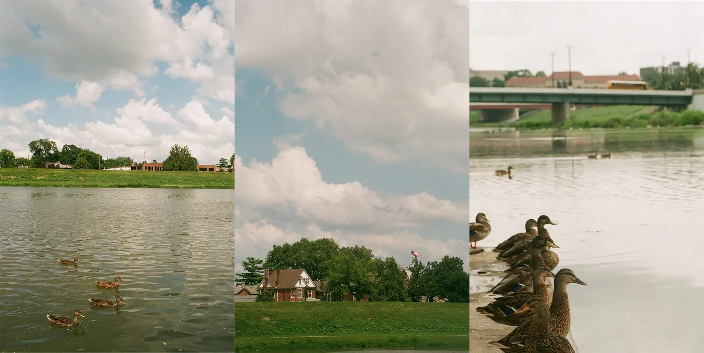

# Week0 Day2

`devops`

### 5 things to bring to a desert island
1. Knife
2. Water container
3. First aid kit
4. Tent
5. Fishing Rod
> Our group decided to choose five essential items that would help us survive on a desert island. First, we picked a knife, because it is very useful for cutting, hunting, and protecting ourselves. Second, we chose a water container so we can store and carry clean water. Third, we added a first aid kit to take care of any injuries or health problems. Fourth, we selected a tent, which can give us shelter and protection from the sun or rain. Finally, we chose a fishing rod to provide us with a continuous source of food. Together, these five items cover the most important needs for survival: food, water, shelter, and safety

Homework: **My Special Place**
[My Special Place](https://ironhack.typeform.com/spe-place-sda)

## Great Miami River
- Right by my house
- Has ducklings (mallards) and geese that attack you 
- In the winter it froze many times
- Quiet and relaxing
