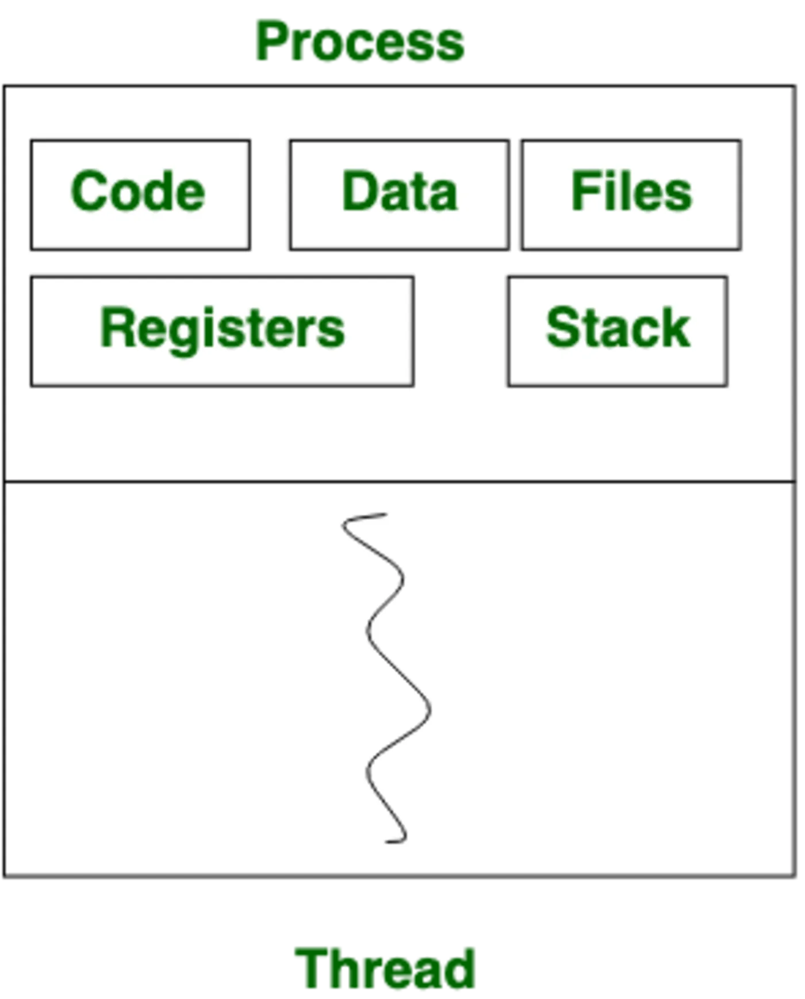

<!-- imported from ObsidianVault/webdev/interviews/Interview prep.md. Edit the source, then run sync.py. -->

# Interview prep

`interview`

- **Get to Know Aramco Products**
- Revise CV projects
- Revise Grad Project: I was tasked with setting up the raspberry pi with the LiDAR sensor, but since the LiDAR sensor arrived broken, I suggested we use 4 ultrasonic sensors on each side of the drone and just periodically take a snapshot of distances read from the sensors and then letting the drone move towards the largest value. To connect the RPi to the controlling device I used mavlink, and to command the drone I used arduPilot. Communication between the controlling device and the drone was done over WiFi. talk about algo
- Revise CV Tools

Grad project: The graduation project was a team effort. The main idea was to create a low-cost, disposable, autonomous drone equipped with an obstacle avoidance system and LiDAR to map its environment. It would be deployed in hazardous situations, such as a burning building to map the surrounding and detect survivors.

* low-cost, disposable, autonomous drone equipped with an obstacle avoidance system and LiDAR --> what use?
* main use: fires --> what did I do?
* tasks: setup RPi, establish a connection with the control device (mavlink), setup manual controls for override and work on obstacle avoidance algo. --> algo explain
* algo: Threshold distance, if <, move to another side --> circle issue
* avoiding circles --> sensor issue
* issues with lidar: switch to 4-ultrasonics -> and after that?
* finally: achieved autonomous object avoidance

**Questions to prep:**
### 1. Tell us about 
Read Example and [[questions]]
 self-directed
 photography incorporated in project
 patience
 communication
 ardupilot =software that connects and controls the flight controller
 mavlink =creates a connection to the drone to be controlled
 time management due to juggling between work and education
 stress pressure = i see as motivators.
 Well, everyone knows ARAMCO as an oil and gas company, but in the last 2 years with the opening of aramco digital as a subsidiary, making deals and collabs with technology giants like qualcomm, amd, I believe that ARAMCO will also be a pioneer in the technology industry, just as much as it is an oil and gas giant. And I love companies that adapt, advance, and progress 
 
```python
THRESHOLD = 40 # 40cm
def decide_movement(distances): 
	front, back, left, right = distances["front"], distances["back"], distances["left"], distances["right"] 
	if front < THRESHOLD:
		if right > THRESHOLD: 
			send_movement_command(roll=200) # Move right
			return "Moving Right" 
		elif left > THRESHOLD: 
			send_movement_command(roll=-200) # Move left
			return "Moving Left" 
		elif back > THRESHOLD: 
			send_movement_command(pitch=-200) # Move backward 
			return "Moving Backward" 
		else: 
			return "Hovering (Blocked on all sides)" 
	if left < THRESHOLD: 
		send_movement_command(roll=200) # Move right 
		return "Moving Right" 
	if right < THRESHOLD: 
		send_movement_command(roll=-200) # Move left 
		return "Moving Left" 
	send_movement_command(pitch=200) # Move forward 
	return "Moving Forward"
```
#### Short Intro
Hello, thank you for giving me the opportunity to interview here today. My name is Ali Aljaffer. I recently graduated from Wright State University with a Bachelor's of Science in Computer Science, Summa Cum Laude with a Minor in Mathematics. During my studies at the university, I was recruited at the start of my second year and worked as a student-employee as a Teaching Assistant for two C.S. courses: CS I and OS Usage. As a TA, I was responsible for conducting lab sessions, preparing presentations, holding office hours, grading student work, and lead a team of two TA assistants. 
#### Formula
1. Who you are
2. Your highlight reel
3. Why you're here
---
### Strengths
4. Name a strength that matches a key competency for the role
5. Tell a story that illustrates that strength
---
### Why you
1. Review the role
2. Detail relevant skills
3. Is that how you see me in this role?
---
1. What is your biggest weakness: I tend to hyper-focus on my assigned tasks and sometimes get into a tunnel vision mindset, especially with programming. However, I learned to shake  myself out of this mindset by taking a 1-2 minute break and resetting with maybe a cup of water or tea.
2. What is your biggest strength: Self-sufficiency, but not to the point where I refuse or not ask for help when I realize that I need it. I'll try to solve a problem on my own, do my due diligence on research, but when I feel like I haven't solved it yet, that's when I'll reach out to my team or manager.
3. Why should we choose you to perform this job?: [[why-you|Why you]]
4. Salary expectations?
	1. Give a range
5. When can you start?
	1. Give any
6. A problem you faced in the past?
	1. Me and the group of TAs I managed would split efforts in grading 60-70 students worth of work, and I rarely received the grading 
7. Do you have any questions?
	1. What employee development benefits do you offer? I'm passionate self-learner, using platforms like **Udemy** and **Coursera** to find courses about subjects that interest me. Is there some kind of financial or career-developmental aid offered?
	2. How do you measure performance in the IT department?
8. Stressful situation and how you solved it: Exam times were approaching, so my office hours were crowded, like queues of 5-10 people waiting at the door, with 2 inside the office asking me questions. After I was done, knowing I had another session two days later, I talked to my TAs and organized a study session inside one of the university halls where students split up sitting on round tables, and me and the team would each sit at a table answering questions and rotating tables.

Operating system: An intermediary system that comes between the computer and the user. It's responsible for managing resources, program execution, managing memory and files, I/O operations, security, user & identity, etc.

What is OOP: Object Oriented Programming is a programming paradigm that treats real-world entities as objects. Each object can have certain attributes, and perform certain actions. Classes in OOP are templates for creating an object. For example, a Date class can have attributes like: year, month, day, and actions like addDays, countDaysBetweenDates, and more. OOP concepts include inheritance, encapsulation, polymorphism.

Inheritance: The ability for a class to inherit the fields and methods of another class.

Stack: A LIFO data structure that is usually implemented internally as a linked list.

Queue: A FIFO data structure used to keep order on tasks to perform. Priority Queue is a variant of the Queue that can give priority to certain tasks in the queue to be performed before others.

C vs java: C is a low-level programming language. Programs written in both C and Java will perform better running on C due to it being low-level and Java needing to run on the Java Virtual Machine. 

Garbage java

Water fall

TCP vs UDP: They're different ways to send information on a network. TCP has built in checks to make sure all the data gets there in the correct order, but that means it takes longer to since all those checks take more time. UDP just sends all the data but doesn't check to make sure it all arrived. It's a lot faster, but less reliable.

Class: Template for creating objects, specifies their attributes and actions done by and on the object.

Objects: Are created from classes. They represent real-world entities and are a main part of OOP.

Array vs linked-list: 

Show files in linux

Threads: Smaller and faster form of processes. A thread always belongs to some process. NOT ISOLATED.


Process: Isolated programs that are scheduled to run. Can create child processes. States: new, ready, running, waiting, terminated and suspended.

Process vs Threads

Algorithm

talk about yourself in 5 minutes

[[networking/osi-model|OSI layers]]:
- **Physical Layer**: This is the hardware part of communication, like cables, switches, and electrical signals. It sends raw bits over the physical medium.
- **Data Link Layer**: Ensures that data is transferred error-free over the physical link. It also handles addressing on a local network (MAC addresses).
- **Network Layer**: Responsible for routing data between devices on different networks. It uses IP addresses to decide the best path for data to travel.
- **Transport Layer**: Ensures data is transferred reliably between devices. It handles things like error checking, flow control, and data segmentation. Common protocols here are TCP and UDP.
- **Session Layer**: Manages the opening, closing, and managing of communication sessions between devices. It keeps track of who is communicating and when.
- **Presentation Layer**: Translates data into a format that the application layer can understand. It also handles encryption and compression.
- **Application Layer**: This is the closest layer to the user. It's where network services like web browsing (HTTP), email (SMTP), and file transfer (FTP) operate.

GUI

Software development

Encapsulation

Upcast downcast

Uncode

Encryption

Encapsulation

Interface

Abstraction

Polymorphism

Cables type

Hub

Switch

Router

IP address

Private IP address

## FAQs – Java OOPs Concepts

### What is OOPs concept in Java?

> OOPs (Object-Oriented Programming) is a programming paradigm based on the concept of objects, which can contain data in the form of fields (attributes or properties) and code in the form of procedures (methods or functions). In Java, OOPs concepts include encapsulation, inheritance, polymorphism, and abstraction.

### Why is OOPs important in Java?

> OOPs helps in organizing and structuring code in a more manageable way, making it easier to maintain and scale Java applications. It also promotes code reusability, modularity, and flexibility, leading to efficient and robust software development.

### What are the main principles of OOPs in Java?

> The main principles of OOPs in Java are encapsulation, inheritance, polymorphism, and abstraction. Encapsulation ensures that the internal state of an object is hidden and can only be accessed through public methods. Inheritance allows one class to inherit properties and behavior from another. Polymorphism enables objects to be treated as instances of their parent class. Abstraction focuses on hiding the implementation details and showing only the necessary information to the outside world.

### How is OOPs implemented in Java?

> In Java, OOPs is implemented through classes and objects. A class serves as a blueprint for creating objects, which are instances of that class. Each object has its own set of attributes (variables) and methods (functions). By following OOPs concepts like encapsulation, inheritance, polymorphism, and abstraction, Java developers can design well-structured and maintainable code.

### What are the advantages of using OOPs in Java?

> Some advantages of using OOPs in Java include code reusability, modularity, flexibility, scalability, and easier maintenance. OOPs enables developers to model real-world entities as objects, leading to more intuitive and organized code. It also supports features like inheritance and polymorphism, which enhance the extensibility and readability of Java applications.

### Can you provide an example of OOPs concept implementation in Java?

> Sure! An example of OOPs concept implementation in Java is creating a ‘Car’ class with attributes like ‘make’, ‘model’, and ‘year’, along with methods like ‘start()’, ‘accelerate()’, and ‘stop()’. By instantiating objects from the ‘Car’ class and calling its methods, we can simulate the behavior of different car instances in a structured and object-oriented manner.
