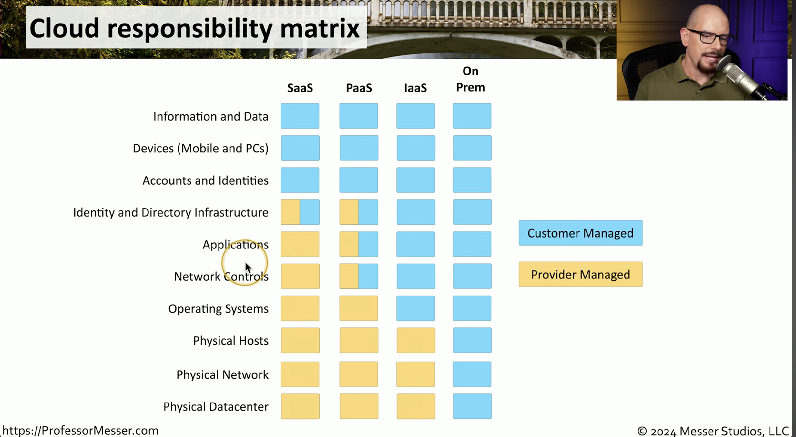
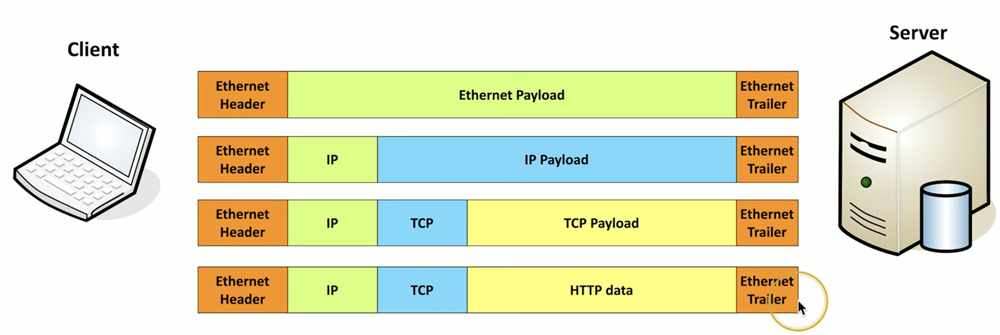

<!-- imported from ObsidianVault/studies/networking/main.md. Edit the source, then run sync.py. -->

# Main

`networking` `devices`

[[osi-model|OSI Model]]
## Layer 1 devices:
1. Analog modem
2. Hub: Does not care where the signal comes from or where it's going, just repeats the signal to the ports.
## Layer 2 devices:
1. Switch: few ports, or many, can be simple/complex, only communicates with local network devices. Smarter than a hub. uses an ASIC chip.
2. Wireless access point (WAP): Connects wireless to wired, a bridge. Most common: bridges 802.11 wireless to 802.3 ethernet.
## Layer 3 devices:
1. Multilayer switch (MLS): can communicate and pass data to non-local network devices. Expensive.
2. Router: Most common network device. Uses software as opposed to ASIC chip. Can communicate with local and non-local devices. Most cases will have a **router** with less ports than a **switch**. Routes traffic between IP subnets.
## Security devices
### Firewall 
Can be software based, or it's own device. 
Operates on layers 2,3,4, 7 [[osi-model|OSI Model]]
It blocks packets from entering or leaving the network:
1. Via stateless inspection: inspects all packets against a set of rules.
2. Via stateful inspection: Only examines the state of the connection between networks. I.e. when a. connection is made from an internal network to an external one, the firewall will not examine any packets returning from the external connection. As a general rule, external connections are not allowed to be initiated with the internal network.
It is the first line of defense in protecting the internal network from outside threats.
### Intrusion detection system (IDS)
Passive system, monitors when a network breach or attack is occurring. It receives a copy of all traffic and evaluates with these standards:
1. Signature based
2. Anomaly based
3. Policy based
### Intrusion prevention system (IPS)
Active system, designed to stop an attack by deploying an action or set of actions to stop the attack. For it to work, all traffic must flow through the IPS by being between the router (with a firewall) and the destination network segment

Detection - Alarm or alert
Prevention - Stops the attack
### Virtual Private Network (VPN) concentrator
Layers: 2,3,7.
...is used by remote hosts to access a private network through an encrypted tunnel through a public network. Once connected, remote hosts are seen as on-premise hosts.

#### Types:
1. Site-to-Site VPN: Allows a remote site's network to connect to the main site's network and be seen as a local network segment.
2. Host-to-site VPN: Remote access VPN allows select remote users to connect to the local network. Remote system will use a vpn client software to make the connection.
3. Host-to-Host VPN: Allows a secure connection between two systems without the use of VPN client software.
#### Protocols
##### Internet Protocol Security (IPsec): 
Works at layer 3. A protocol suite. 
Can be used with Authentication Header (AH) protocol. 
Can be used with Encapsulating Security Payload (ESP): Transport mode or tunnel mode. 
**ISAKMP**
##### Generic Routing Encapsulation (GRE)
GRE is a tunneling protocol that is capable of encapsulating a wide variety of network layer protocols.
##### Point-to-Point Tunneling Protocol (PPTP)
Dial up VPN connections.
##### Transport Layer Security (TLS)
Cryptographic protocol used to create a secure encrypted connection between two end devices or applications.
Layers >= 5
Commonly used to create a secure encrypted internet session.
##### Secure Socket Layer (SSL)
older protocol similar to TLS
commonly used in internet transactions
## Optimization and performance devices
### Load balancer
content switch/filter.
A network appliance that is used to load balance between multiple hosts that contain the same data - spreading out the workload for greater efficiency.
- Configurable load
- TCP offload
- SSL offload
- Caching
- Prioritization
- Content-switching
	- Balance based on webpage requested (each webpage to specific server)
### Proxy server
- Requests resources on behalf of client machines to protect their identity. 
- Sits between the users and the external network.
- Useful for caching info, access control, URL filtering, content scanning
## Storage 
### Network Attached Storage NAS
- Connect to a shared storage device across network
- File-level access
	- File must be pulled to machine
### Storage Area Network SAN
- Looks and feels like a local storage device
- Block level access
- Very efficient reading and writing
- Requires a lot of bandwidth.
## Network devices
## Access Points
- Not a wireless router!
- A bridge extending a wired network into wireless
### **Wireless LAN controller**
- Centralized management of multiple access points
- Deploy new access points
- Performance and security monitoring
- Configure and deploy changes to all sites
- Report on AP use
- Usually proprietary (belonging to the same manufacturer as APs)
### Networking Functions
- Access to important data
- Remote access
- Traffic management
- Protocol support
### Content Delivery Network (CDN)
- Speeds up the process of data delivery
- Geographically distributed caching servers
### Virtual Private Network
- use Concentrator or head-end to manage VPN connections
	- Encryption/decryption access device
	- Often integrated into a firewall
### Quality of Service (QoS)
- Traffic shaping, packet shaping (Prioritization)
- Control by bandwidth usage or data rates
- Routers, switches, firewalls to manage QoS
### Time to Live (TTL)
- How long data is available?
- Can be used to prevent routing loops
### Internet Protocol (IP)
- Loops could cause a packet to live forever
- Each pass through a router is a hop
- Default TTL for Mac/Linux is 64 hops, and 128 hops for Windows
- On average, you need 12-16 hops.
### Domain Name System (DNS)
- Translates hostnames to IP addresses
## Building the Cloud
### Virtual Networks
- Network function virtualization
	- Replace physical network devices with virtual versions
### Virtual Private Cloud
- Transit Gateway is a cloud router that connects multiple VPCs
- Internet gateway allows access over the internet to your application VPC
- VPC NAT Gateway is used to allow outbound communication to the internet, but not necessarily inbound.
- VPC Endpoint sets up a direct connection between cloud provider networks
### Security lists / Access Control Lists
- Adds inbound/outbound rules that apply to all VPCs
### Network security group / Security Group
- Adds more granularity to ACLs
- Rules are specific to devices and network connections
### Software as a Service (SaaS)
- On-demand software
	- No local installation
- Central management of data and applications
- Complete application offering
- Example: Google Mail, Office365
### Infrastructure as a Service (IaaS)
You want to code your application, but need hardware and resources
- You're still responsible for the management and security
- Your data is on the cloud
### Platform as a Service (PaaS)
- No servers, no software, no maintenance team. Someone else handles the platform, you handle the development
- You don't have direct control of the data, people, or infrastructure.
	- Trained security professionals are watching your stuff
- Example: SalesForce

## Introduction to IP

### TCP vs UDP
Transported inside of **IP**
OSI Layer 4 (Transport)
Multiplexing, the ability to use many different apps at the same time

| Protocol/Feature | TCP                                                                         | UDP                                                          |
| ---------------- | --------------------------------------------------------------------------- | ------------------------------------------------------------ |
| Delivery         | Reliable, recovery from errors, device confirms data delivery, but **SLOW** | Unreliable, no error recovery no reordering of data**FAST**! |
| Connection       | Opens and closes connection                                                 | Connectionless, no formal open or close connections          |
| Flow Control     | The receiver can manage how much data is sent                               | No flow control, sender determines the amount of data sent   |
### List of Ports
#### IPv4 Sockets
- Server IP address, protocol, server application port number
- Client IP address, protocol, client port number
#### Non-ephemeral ports - permanent port numbers
- 0 - 1,023
- usually on a server or a service
#### Ephemeral ports - temporary
- 1024 - 65,535
#### TCP and UDP
- 0 - 65,535
- The two are not the same! TCP 80 $\neq$ UDP 80
**Port numbers are for communication, not security!**
## Common Ports
### File Transfer Protocol (FTP)
- Transfer files between systems
- Auth: User/Pass
- tcp/20 - Data transfer port
- tcp/21 - Control port
### Secure Shell (SSH)
- Secure remote connection
- tcp/22
### Secure FTP (SFTP)
- Encrypted file transfer
- tcp/22
### Telnet
- Non-encrypted remote connection via console
- tcp/23
### Simple Mail Transfer Protocol (SMTP)
- Server to server email transfer
- tcp/25 - PLAINTEXT EW
- tcp/587 - (SMTP using TLS encryption)
- For email receiving: IMAP, POP3
### Domain Name System (DNS)
- udp/53
- tcp/53 for large transfers
### Dynamic Host Config. Protocol (DHCP)
- Automated config. of IP address, subnet mask
- Dynamic / pooled: Each system is given a lease time
- DHCP reservation
- udp/67, udp/68
- Requires DHCP server
### Trivial File Transfer Protocol (TFTP)
- very simple file transfer
- no auth
- useful when starting a system
- udp/69
### HTTP and HTTPS
- HyperText Transfer Protocol
- tcp/80 (HTTP) - PLAINTEXT
- tcp/443 (HTTPS) - SSL/TLS encrypted
### Network Time Protocol (NTP)
- Switches, routers, firewalls, servers, etc sync their time
- udp/123
- Automatic updates
### Simple Network Management Protocol (SNMP)
- Gather statistics from network devices 
- udp/161
- v1 - the original
	- Plaintext
	- structured tables
- v2
	- data type enhancements
	- bulk transfers
	- plaintext
- v3
	- SECURE
	- message integrity
	- authentication
- SNMP trap - udp/162
	- alerts and notifs from other network devices
### Lightweight Directory Access Protocol (LDAP)
- Store and retrieve information in a network directory
- tcp/389
- LDAPS - LDAP + SSL tcp/636
### Server Message Block (SMB)
- File sharing, printer sharing
- also called Common Internet File System CIFS
- Built-into Windows
- tcp/445 - plaintext
### Syslog
- Standard for message logging
- Usually used with SIEM
- udp/514
### Databases (SQL)
- Microsoft SQL Server MS-SQL - tcp/1433
### Remote Desktop Protocol (RDP)
- Share a desktop from a remote location
- tcp/3389
### Session Initiation Protocol (SIP)
- Voice-Over-IP (VOIP) 
- tcp/5060
- tcp/5061
## Other Useful Protocols
### Internet Control Message Protocol
Text messaging for network devices to communicate 
### Generic Routing Encapsulation
- The "Tunnel" between two endpoints
