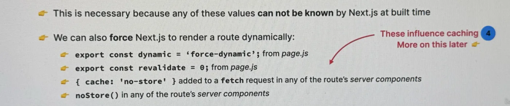

# React

`react`

## Installation

[[react-installation]]

[[main-concepts|react/main-concepts]]
## Hooks

[[usestate|useState]]

[[useref|useRef]]

[[useeffect|useEffect]]

[[usereducer|useReducer]]
## Routing with React Router

`npm i react-router-dom@6`

[[react-router-setting-routes|setting-routes]]

[[react-router-loaders|loaders]]

[[react-router-forms|forms]]

[[react-router-link|link]]

[[react-router-error-handling|error-handling]]

Note the name: [[react-router-usenavigate|useNavigate]]

Note the name: [[react-router-usenavigation|useNavigation]]

[[react-router-useparams-usesearchparams|useParams-useSearchParams]]

[[react-router-outlet|outlet]]

[[react-router-usefetcher|useFetcher]]

[[react-router-revalidation|revalidation]]

[[performance-optimizations|Performance Optimizations]]
## Redux

`npm i react-redux`

- First, know [useReducer()](#usereducer)

- Get the `dispatch` function using the `useDispatch()` hook inside a subscribed component of the `store`

- Action creator function - A function created inside the slice that performs an action using the reducer

- `dispatch()` communicates with the STORE. The STORE contains multiple `reducers`, one `reducer` per feature. (Shopping cart/user data/theme)

- `reducer()` takes `initialState` as `state` default value

- `reducer` returns the state unmodified in the `default` case in `Redux`.

- Each slice exports its `reducer` function, which is then imported in the store.

- `useSelector()` takes in a callback that has 1 arg, `store`. This store will contain the current states.

- Don't perform `async` operations in `store`, and keep reducers pure.

- To perform an `async` operation, use `middleware`: a function that mediates between `dispatch()` and `store`

- Middleware is perfect for side effects, api calsss, timers, etc.

### Providing the Store

```js
import { Provider } from "react-redux";
import store from "./store";
const root = ReactDOM.createRoot(document.getElementById("root"));
root.render(
  <React.StrictMode>
    <Provider store={store}>
      <App />
    </Provider>
  </React.StrictMode>
);
```

### Thunk (Middleware)

`npm i redux-thunk`

Used for "delaying" dispatching an action until another action has performed. Commonly used for API calls, side effects, timers, etc.
Usually want to dispatch an action that tells the store that we are loading data, then when done, the dispatched final action
should tell the store we are no longer waiting for data

```js
export function deposit(amount, currency) {
  // Normal operation where conversion isn't necessary
  if (currency === "USD") return { type: "account/deposit", payload: amount };
  // note the params of the function below
  return async function (dispatch, getState) {
    // API Call
    const host = "api.frankfurter.app";
    const res = await fetch(
      `https://${host}/latest?amount=${amount}&from=${currency}&to=USD`
    );
    const data = await res.json();
    const converted = data.rates.USD;
    // dispatch action
    dispatch({ type: "account/deposit", payload: converted });
  };
}
```

- To use, pass a `thunk` object into `createStore()`'s `applyMiddleware()`:

```js
const rootReducer = combineReducers({
  account: accountReducer,
  customer: customerReducer,
});

import { thunk } from "redux-thunk";
const store = createStore(rootReducer, applyMiddleware(thunk)); // <------
```

- Return an async function that does the API calling and then dispatches an action when done

### Thunks in Redux Toolkit

`createAsyncThunk()`: Takes 2 args: action name, ie `user/fetchAddress`, and an async function that returns the payload. The async function runs as soon as the action `user/fetchAddress` dispatches.
This function provides 3 statuses: **fulfiller, pending, rejected**

Handle all 3 statuses by adding extraReducers with addCase. addCase takes 2 args: status , and reducer that should handle the status

```js
const userSlice = createSlice({
  name: "user",
  initialState,
  reducers: {
    // Can mutate in Redux Toolkit
    updateName(state, action) {
      state.username = action.payload;
    },
  },
  extraReducers: (builder) =>
    builder
      .addCase(fetchAddress.pending, (state, action) => {
        state.status = "loading";
      })
      .addCase(fetchAddress.fulfilled, (state, action) => {
        state.position = action.payload.position;
        state.address = action.payload.address;
        state.status = "idle";
      })
      .addCase(fetchAddress.rejected, (state, action) => {
        state.status = "error";
        state.error = action.error.message;
      }),
});
```

### Redux Devtools

Use `composeWithDevTools()`

```js
import { applyMiddleware, combineReducers, createStore } from "redux";
import accountReducer from "./features/accounts/accountSlice";
import customerReducer from "./features/customers/customerSlice";
import { composeWithDevTools } from "@redux-devtools/extension/";
import { thunk } from "redux-thunk";
const rootReducer = combineReducers({
  account: accountReducer,
  customer: customerReducer,
});

const store = createStore(
  rootReducer,
  composeWithDevTools(applyMiddleware(thunk))
);

export default store;
```

### Redux Toolkit (RTK)

`npm i @reduxjs/toolkit` then import `configureStore` from `@reduxjs/toolkit`

- Enforces best practices

- Less boilerplate

- We can write code that mutates state inside reducers (Will be converted to immutable logic behind the scenes by Immer library)

- Action creators are automatically created

- Automatic setup of Thunk middleware and dev tools

- Created actions only allow one arg to be passed to `action()`

Solution: Prepare the data with `prepare()`

```js
requestLoan: {
      // This receives the arguments needed and does the preparing and side-effects
      prepare(amount, purpose) {
        return {
          payload: { amount, purpose },
        };
      },
      reducer(state, action) {
        if (state.loan > 0) return;
        state.loan = action.payload.amount;
        state.loanPurpose = action.payload.loanPurpose;
        state.balance = state.balance + action.payload.amount;
      },
    },
```

#### Steps for RTK

1. Create a `Slice` file with the format `[feature]Slice.[js | jsx | tsx]`. In this case it's `accountSlice.js`

2. Import `createSlice` from RTK.

3. Create an initial state object, i.e. `initialState`

4. Create an `accountSlice` this way:
    ```js
const accountSlice = createSlice({
      name: [Name here],
      initialState: [initial state variable here]
      reducers: [reducer functions here]
    })
  ```

  - For the "reducer functions", you'll just supply actions that should happen to the feature itself. I.e. for accounts,
    you can `withdraw`, `deposit`, etc. Each take as args `state` and `action`

5. Now export the actions as const named exports, and the reducers as default

```js
export const { withdraw, requestLoan, payLoan } = accountSlice.actions;
export default accountSlice.reducer;
```

6. In a central `store.js` file, import the `accountReducer` from the `accountSlice.js` file.

7. Import `configureStore` from RTK and create a `store` variable. Pass an object with `reducer` key for every slice and its reducer.

```js
import { configureStore } from "@reduxjs/toolkit";
  const store = configureStore({
    reducer: {
      account: accountReducer,
      customer: customerReducer,
    },
  });
```

8. In `index.js` import the `store` we just made and supply it to the entire app with the provider

 ```js
  import { Provider } from "react-redux";
  import store from "./store";
  const root = ReactDOM.createRoot(document.getElementById("root"));
  root.render(
    <React.StrictMode>
      <Provider store={store}>
        <App />
      </Provider>
    </React.StrictMode>
  );
```

9. To get a state, use the `useSelector()` hook: `const balance = useSelector(state => state.account.balance)`

10. To dispatch an action, grab the dispatcher with `useDispatch()` hook and dispatch a defined action

```js
  const dispatch = useDispatch();
  function handleRequestLoan() {
    if (!loanAmount || !loanPurpose) return;
    dispatch(requestLoan(loanAmount, loanPurpose));
    setLoanAmount("");
    setLoanPurpose("");
  }
  ```

## Redux vs [[main-context-concepts|Context API]]

### Pros and Cons

| Context API + useReducer                                                | Redux                                                          |
| :---------------------------------------------------------------------- | :------------------------------------------------------------- |
| **+** Built into React                                                  | **-** Requires additional package (larger bundle size)         |
| **+** Easy to set up in a **single context**                            | **-** More work to set up intially                             |
| **-** Additional state "slice" requires new context set up from scratch | **-** Once set up, it's easy to create additional state slices |
| **-** No mechanism for async operations                                 | **+** Supports middleware for async operations                 |
| **-** Performance optimization is a pain                                | **+** Performance is optimized out of the box                  |
| **-** Only React DevTools                                               | **+** Excellent DevTools                                       |

### Using reducers inside other reducers with caseReducers

```js
deleteItem(state, action) {
  // payload = pizza ID
  state.cart = state.cart.filter(
    (pizza) => pizza.pizzaId !== action.payload,
  );
},
increaseItemQuantity(state, action) {
  // payload = pizza Id
  const item = state.cart.find((item) => item.pizzaId === action.payload);
  item.quantity++;
  item.totalPrice = item.quantity * item.unitPrice;
},
decreaseItemQuantity(state, action) {
  // payload = pizza Id
  const item = state.cart.find((item) => item.pizzaId === action.payload);
  item.quantity--;
  item.totalPrice = item.quantity * item.unitPrice;
  if (item.quantity === 0) cartSlice.caseReducers.deleteItem(state, action); // LOOK HERE!
},
```

## Usage Cases

| Context API + useReducer                                                                           | Redux                                                                                                        |
| :------------------------------------------------------------------------------------------------- | :----------------------------------------------------------------------------------------------------------- |
| Global state management in **small** apps                                                          | Global state management in **large** apps                                                                    |
| When you need to share a value that doesn't change often [Color theme, preferred language, etc...] | When you have lots of global UI state that needs to be updated frequently [Shopping cart, current tabs, ...] |
| When you need to solve a simple [[prop-drilling|prop drilling]] problem                                              | When you have complex state with nested objects and arrays                                                   |
| When you need to manage state in local sub-tree of the app                                         |                                                                                                              |

## TypeScript

- `npm i --save-dev typescript-eslint`

- in `eslint` config file add: `"parser": "@typescript-eslint/parser"`

Guide Here

# Planning a Project - Fast React Pizza Co.

1. Gather application requirements and features
2. Divide the application into pages

   2.1. think about the overall and page-level UI

   2.2. Break the desired UI into components

   2.3. Design and build a static version without state

3. Divide the application into feature categories

   3.1. Think about state management + data flow for each category.

4. decide on what libraries to use (tech decisions)

## Tailwind Prettier

[Installation](https://tailwindcss.com/docs/installation)

`npm install -D prettier prettier-plugin-tailwindcss`

```json
// .prettierrc
{
  "plugins": ["prettier-plugin-tailwindcss"]
}
```

## Tailwind

- Extend `screen` height to `100dvh` instead of `100vh` and REPLACE sans family with `Roboto`

```js
/** @type {import('tailwindcss').Config} */
// eslint-disable-next-line
export default {
  content: ["./index.html", "./src/**/*.{js,ts,jsx,tsx}"],
  theme: {
    fontFamily: {
      sans: "Roboto Mono, monospace",
    },

    extend: {
      height: {
        screen: "100dvh",
      },
    },
  },
  plugins: [],
};
```

- Buttons: On focus, use outline none, offset 2, color, and `focus:ring`

- Adding a class `input` that uses tailwind classes

```css
@layer components {
  .input {
    @apply w-full rounded-full border border-stone-200 px-4 py-2 transition-all duration-300 placeholder:text-stone-400 focus:outline-none focus:ring focus:ring-sky-400 focus:ring-offset-2 md:px-6 md:py-3 md:text-sm;
  }
}
```

# More tools

## React Query

- Remote state manager

- Cached data

- isLoading and isError

- pre-fetching

- offline support

onSuccess, invalidate the queries, leading the page to refresh

```js
const queryClient = useQueryClient();
const { isLoading: isDeleting, mutate } = useMutation({
  mutationFn: (id) => deleteCabin(id),
  onSuccess: () => {
    queryClient.invalidateQueries({
      queryKey: ["cabins"],
    });
  },
  onError: (err) => {
    alert(err.message);
  },
});
```

### Prefetching with React Query

```js
const queryClient = useQueryClient();
queryClient.prefetchQuery({
  // your query here
  // for example page + 1
});
```

## lib: Toasts (Notifs)

`npm i react-hot-toast`

## lib: React Form Hook

`npm i react-form-hook`

1. get `register, handleSubmit` from `useForm()` hook

2. Register each input element by adding prop `...register("id_here")`

# Advanced Patterns

## Render props

Telling the component exactly what to render by passing it a function. (Inversion of Control)

Pass the `render` element prop a function and when using a map on a list of items to display, just pass it the render function

## Higher-order Components

Components that "enhance" a component that is not open for change.

Starts with `with` keyword and then the name of the feature it's adding. `withToggling`

## Compound Components

Multiple components build together to form the compound component, using Context API.

```js
// Start with context
const CounterContext = createContext();
// Create a parent
const Parent = ({children}) => {
  <CounterContext.Provider value={{ A, B, C }}>
    {children}
  </CounterContext.Provider>;
};
// create child comps
const ValueAHandler = () => {
  const { A } = useContext(CounterContext);
  return <div>{A}<div>;
};

const ValueBHandler = () => {
  const { B } = useContext(CounterContext);
  return <div>{B}<div>;
};

const ValueCHandler = () => {
  const { C } = useContext(CounterContext);
  return <div>{C}<div>;
};
// add children as props
Parent.A = ValueAHandler;
Parent.B = ValueBHandler;
Parent.C = ValueCHandler;
```

## React Portals

Used to position a component or element on a different element of the DOM tree without changing it's actual position on the Virtual DOM. Mostly used on modals to position them inside `<body>`

Example:

```js
createPortal(elementToMove, elementToMoveTo);
```

Usage:

```js
return createPortal(
  <Overlay>
    <StyledModal>
      <Button onClick={close}>
        <HiXMark />
      </Button>
      <div>{cloneElement(children, { onCloseModal: close })}</div>
    </StyledModal>
  </Overlay>,
  document.body
);
```

## Supabase

Authentication Providers: Can enable log-in using different services (Google, Apple, Email, Phone, etc)

API Docs contain Authentication as well.

User Management for sign up, sign in, forgot password

## Route Protection

Use Protected Route around the application/applayout

```js
function ProtectedRoute({ children }) {
  // 1. Load authenticated user
  () => {
    getSession() from supabase,
    if(!session) return null;

    get data, error from supabase.auth.getUser();

    return data?.user;
  }

  // 2. Show a spinner while loading

  check user.role === 'authenticated'
  // 3. Redirect to login if no authenticated
  navigate('/login')
  // 4. If authenticated, render app
  return children;
}
```

use `queryClient.setQueriesData(key,value)` to set values in React Query Cache

# Server-Side Rendering

E-Commerce, blogs, news, marketing websites, all benefit from SSR due to SEO-friendliness

Types:

1. Static: Generated at build time

2. Dynamic: Generates new HTML for every new request

## Hydration

Adds back interactivity and event handlers that were lost when html was server-side rendered

Common errors:

incorrect HTML nesting, different data used for rendering, using browser-only APIs (window, document), side effects

```js
ReactDOM.hydrateRoot(document.getElementById("root"), <Menu />);
```

# Next.js

- Supports Static and Dynamic SSR.

- Folders as routes, special file conventions for pages, layouts, loaders, etc

- Fetch data directly in server compoents

- Mutations in server actions

- Optimizations of images, preloading, SEO

## Navigation

To navigate between pages, use Next's [[react-router-link|<Link>]] similar to an anchor element

## RootLayout

Will contain both `<html>` and `<body>` tags!

## React Server Components (RSC)

Default components in apps built on Next.js and Remix. To use REGULAR components, add `use client` to the top. Combines client-side and server-side benefits.

It's enough to specify `use client` for a parent, so the children are implicitly client-rendered.

**RSC:** Full-stack architecture for React apps that introduces the server as an integral part of React component trees (server components). <u>These components are rendered on the server, not the client.</u> They are not included in the bundle.

React can then be used to build the back-end.

## Server vs Client Components

|                 feature                  |                    client components                    |                    server components                    |
| :--------------------------------------: | :-----------------------------------------------------: | :-----------------------------------------------------: |
|                  Usage                   |                      `use client`                       |                         default                         |
|               State/Hooks                |                           Yes                           |                           no                            |
|             Lifting state up             |                           yes                           |                  no (cant have state)                   |
|                  Props                   |                           yes                           | Yes, but must be serializable. No functions or classes. |
|              Data fetching               |                 Yes, but use a library                  |        Preferred. Use async/await in component.         |
|                Importing                 |                 Only client components                  |      Both client and server components components       |
| Can render (One component calls another) | Client components and server components passed as props |            Both client and server components            |
|             When re-render?              |                     On state change                     |               On URL change (navigation)                |

## Deciding Server vs Client Components

Server Components: Find static elements that need no interactivity or that need to be fetched.

Client Components: Interactive elements, such as the filter, sort, and dark mode buttons in Qiddiyah Cabins project.

## Mental Model for RSC

Client components are displayed to form a view. An interaction updating the state re-renders the client component. Server components fetch data and then this data is either rendered to form the view, or passed as props to client components. When a user navigates to a different page, the server component re-renders and then data is fetched again.

## Pros and Cons of RSC

**Pros:**

- We can compose entire full-stack apps with React components alone and server actions.

- One single codebase for front and backend

- Server components have more direct and secure access to the data source (No API, exposing API keys, etc)

- Eliminate client-server waterfalls by fetching all the data needed for a page at once before sending it to the client

- "Disappearing code" as server components ship no JS, so they can import huge libs for free.

**Cons:**

- Increase in complexity

- Hooks don't work on server comps (also Context API)

- More decisions to make whether a comp should be a client or server

- Sometimes you still need to build an API

- Can only be used within a framework

## Into the Next.js

`Loading.ts` global loader. Local loaders can also have their own loader, by creating a `loading.ts` in their local root.

To opt-out from Folder routing, add `_` before the folder name to privatise it.

`@` = Project Root Folder

metadata can be provided in the layout of the app by exporting a `metadata` const. Can also export when inside another page to overwrite metadata. Can export a title object:

```js
export const metadata = {
  title: {
    template: "%s projectName",
    default: "Welcome to projectName",
  },
  description: "Add description for better SEO",
};

// OR to generate metadata dynamically:
export async function generateMetadata({ params }) {
  const { name } = await getCabin(params.cabinId);
  return { title: `Cabin ${name}` };
}
```

**Favicon:** Just name the favicon to `icon.png` and store it in `@/app`

**Fonts:** Import from `next/font` such as `next/font/google` then call the function,

```js
import { Josephine_Sans } from "next/font/google";
const JP = Josephine_Sans({
  subsets: ["latin"], // Alphabet
  display: "swap",
});
JP.className; // Use this in Tailwind classes
```

**Images:** Use Next's `<Image>` components. It serves `webp` images, lazy loads images, and prevents layout shifts because we define the height and width.

Can also change the `quality` prop `0-100` to control the quality of the image.

Use `placeholder` prop set to `blur` to blur the image while it loads. Only works with statically-imported images.

When you want to use `<Image>` but don't want to set height/width, statically import the images (like import at top of file). If not possible, (i.e. waiting for the image from a URL) then put the image inside a container, make the parent `relative`, (OPTIONALLY) give it an aspect ration (i.e. `aspect-square`) and make the Image have the `fill` prop and class `object-cover`.

**Nested Layouts:** Add a `layout.tsx` to the route folder you want to change the layout of.

**Environment Variables:** Create a `.env.local`, access in-app with `process.env.VAR_NAME`.

**Next Image Unconfigured Host:** Provide hostname and path to make life easier.

## [[suspense|Suspense]]

Built-in React component that are not yet ready to be rendered.

Comps suspend when:

- Fetching data

- Loading code

Fallback is displayed when a component is suspended. Note that components don't automatically suspend just because they perform Async. Suspense works with `React Query`, `Next.js`, and `React.Lazy`.

**How to suspend in Next.js:** Move the fetching logic into a separate component, then in the original component, use the fetcher with a Suspense around it.

## Dynamic Route Segments

Routes for `BASE_URL/someFeature/{id}`

Create a folder and use `[nameHere]`, where `nameHere` will be the identifying ID.

A page/layout for a dynamic segment gets access to a `params` prop containing the `nameHere` value.

```js
function Page({ params }) {
  const { nameHere } = params;
  return <div>{nameHere}</div>;
}
```

## Error Handling (Error Boundary)

Include an `error.ts` file in the folder and make it `use client`. The error component accepts an `error` object and a `reset` function to be used on a button.

Only catches errors that happen during rendering. Does not work in the main root layout. That would need `global-error.ts`.

To specifically catch a `Not Found` error, create a `not-found.ts`.

### Error Triggering

You can invoke an error to appear in-line by calling the `notFound()` from `next/navigation`

## Rendering in Next.js

Two types of rendering in Next.js. The rendering is split by routes.

### Static Rendering (Default for Next.js)

HTML is generated at build time, or periodically in the background by re-fetching data.

Useful when data doesn't change often and is not personalized to a certain user.

When deployed to vercel: Each static route is hosted on a CDN.

If all routes in an app are static, the entire app can be exported as a static site (Static Site Generation - SSG)

### Dynamic Rendering

HTML is generated at request time, and useful for personalized user data (carts).

When deployed to vercel: each dynamic route becomes a [[serverless|serverless]] function.

A route switches to dynamic rendering in these scenarios:

- The route has a dynamic segement []

- searchParams are used in the page component `/page?quantity=2`

- headers() or cookies() are used in any of the route's server components

- An uncached data request is used in any of the route's server components



### Partial Pre-Rendering

New rendering strategy, combining both static and dynamic to create pages that render part-static and part-dynamic.

As of Next.js 14, PPR needs to be enabled in config.

We used `<Suspense>` to tell Next which parts are dynamic.

We provide a static fallback to the `Suspense` to be immediately rendered.

## Cont. Rendering

Making Dynamic pages static with `generateStaticParams()` by giving Next.js possible cabinId values for a dynamic route `/cabins/cabinId`

```js
export async function generateStaticParams() {
  const cabins = await getCabins();
  const ids = cabins.map((cabin) => {
    cabinId: String(cabin.id); // Note the cabinId is the same name as the dynamic route. Object[] of cabinIds.
  });
  return ids;
}
```

## Static Site Generation

Add key:`output` with value `export` to `nextConfig` object in `next.config.mjs`

## NextAuth (Auth.js in the future)

1. Create `auth.js` in `_lib`, `npm i next-auth` (Will probably change to Auth.js)

2. Setup ENV with

   a. `NEXTAUTH_URL` -> `http://localhost:3000`

   b. `NEXTAUTH_SECRET` -> `generate secret from vercel`

3. Configure (Google in this case) Google Developer Console, Create Project, APIs & Services, OAuth Consent Screen, External Type.

   a. Now go to Credentials, add URLs same as NEXTAUTHURL,

   b. redirect you get from "Auth.js Google" Doc page `BASE/api/...`

4. After OAuth client creation, copy client ID and secret into `.env`, `AUTH_GOOGLE_ID` and `AUTH_GOOGLE_SECRET`

```js
import NextAuth from "next-auth";
import Google from "next-auth/providers/google";
const authConfig = {
  providers: [Google(
    clientId: process.env.AUTH_GOOGLE_ID,
    clientSecret: process.env.AUTH_GOOGLE_SECRET,
  )]
};
export const { auth, handlers: { GET, POST } } = NextAuth(authConfig);
```

create a route handler `route.js`, `export {GET,POST} from "@/app/_lib/auth"`

## Import vs Render

| can do  |                 client components                  |      server components       |
| :-----: | :------------------------------------------------: | :--------------------------: |
| import? |               Only client components               | client and server components |
| render? | client comp, and server components passed as props | client and server components |

## Notes

```js
const router = useRouter();
router.replace("new-url");
```

To render a server component inside a client component, pass it as prop or children.

## API Endpoints in Next.js

API folder -> `route.js`

export GET() and POST()

return a `Response.json()`, params argument contains path name

## Server Actions

Server actions perform mutations (SET, UPDATE, DELETE). Async functions that work only on the server.

Using the `'use server'` directive. They can be defined as a server action module that get exported.

Server actions are just api endpoints.

Can be called from:

1. `action` attr in a form element. (Client and server components)

2. Event handlers (Only client components)

3. `useEffect` (Only client components)

Server actions can:

1. Perform data mutations

2. Update the UI with new data: Revalidate cach with `revalidatePath` and `revalidateTag`

3. Work with cookies

### useOptimistic

`optimisticDelete`: Delete immediately (visually), and follow it with an `await delete(...)` that actually removes it from the db.
