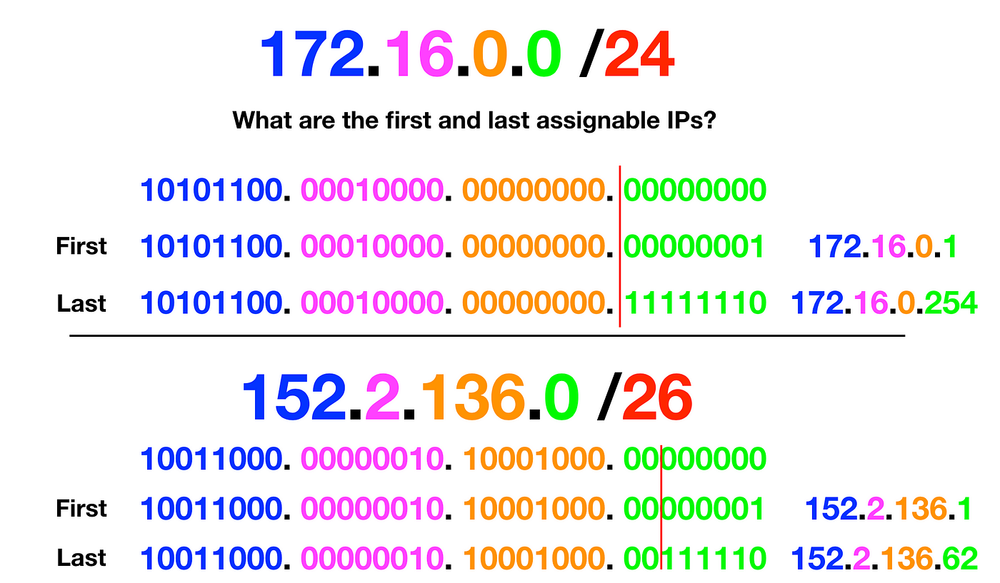

<!-- imported from ObsidianVault/studies/definitions/cidr.md. Edit the source, then run sync.py. -->

# Cidr

`cloud` `fundamentals` `networking`

## 0.0.0.0/X
For every 8X, an entire slot from the left is static.
