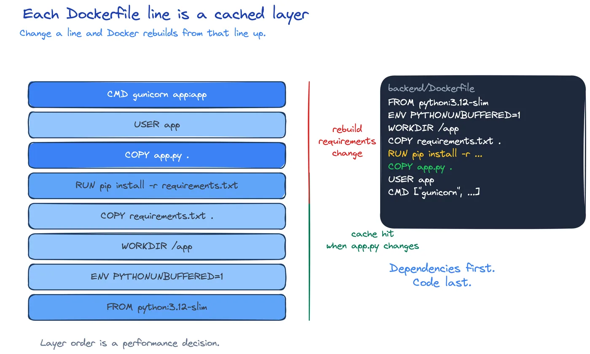
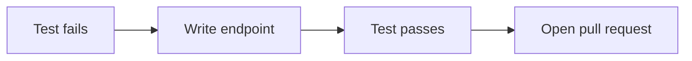

---
tags:
  - docker
  - testing
---

# SWE-04: Add a feature with a test

This page exercises the features a course page needs: code, tabs, notes, diagrams, and a checklist.

!!! note "Why test first"
    A test states the API contract before the code exists. If the test has never failed, it may be testing nothing.

## The endpoint

```python
@app.delete("/api/tasks/<int:task_id>")
def delete_task(task_id):
    with connect_to_database() as connection:  # (1)!
        task = connection.execute(
            "DELETE FROM tasks WHERE id = %s RETURNING id, title, done",
            (task_id,),
        ).fetchone()

    if task is None:
        return jsonify(error="Task not found."), 404
    return jsonify(task)
```

1. The fake connection in the test follows the same chain.

## Run the tests

=== "macOS"

    ```shell
    docker compose -f tools/compose.yaml run --rm python-test
    ```

=== "Windows"

    ```powershell
    docker compose -f tools/compose.yaml run --rm python-test
    ```

??? tip "Expected output"
    ```text
    Ran 5 tests in 0.3s

    OK
    ```

## Checklist

- [x] Write the failing test
- [x] Make it pass
- [ ] Open the pull request

## Diagram



## Flow



## Links

See the [[notes/docker|Docker note]] and the definition of [[rest]]. The API also returns [[status-code|status codes]].

> [!tip] Obsidian callout
> This is written as an Obsidian callout. Check whether it renders as a callout or a plain quote.
